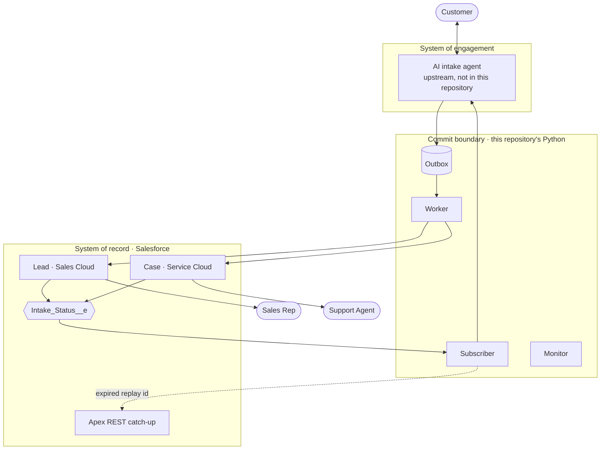
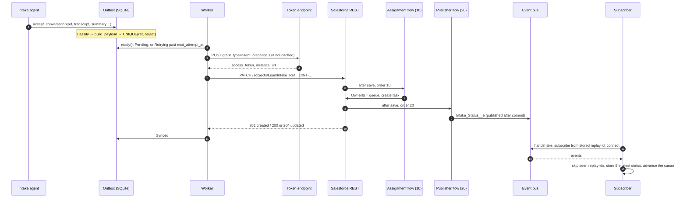
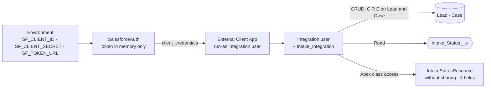

# Architecture

> **Evidence boundary.** This architecture is implemented in source and tested locally in Python. It has not run in a Salesforce org. §8 compares integration platforms, including MuleSoft, as **options only**: no MuleSoft asset exists in this repository.

---

## 1. Context

| Boundary | Owner | Rule |
| --- | --- | --- |
| Before commit | Intake agent | Holds the conversation, the reference, and the summary |
| Commit | Python worker | Delivers one upsert per (reference, object). Never sets owner or status |
| After commit | Salesforce | Owns assignment, tasks, status, and retention |
| Return path | Platform event and Apex catch-up | Carries reference, object, status, and owner name. Nothing else |

## 2. Components

### 2.1 Salesforce (Implemented, not deployed)

| Component | Type | Responsibility |
| --- | --- | --- |
| `Lead.Intake_Ref__c`, `Case.Intake_Ref__c` | Text(40), external id, unique, case-insensitive | Idempotency key and the customer-facing reference |
| `Intake_Summary__c` | Long text 5,000 | The conversation summary (decision D6: kept apart from Description) |
| `Intake_Channel__c` | Restricted picklist: Web, Email, Chat, Phone | Source channel |
| `Lead.Qualification_Reason__c` | Long text 5,000 | Required when an intake Lead is Closed - Not Converted |
| 10 validation rules | Declarative | Format, immutability, required-with-reference, priority, qualification reason |
| `Inbound_Sales`, `Support_Tier_1` | Queues (also Task) | Landing zones. Emails to members off |
| `Lead_Intake_Handling`, `Case_Intake_Handling` | After-save flows, order 10 | Assign the queue, create a task, schedule follow-up |
| `Lead_Status_Publisher`, `Case_Status_Publisher` | After-save flows, order 20 | Resolve the owner name and publish the event |
| `Intake_Status__e` | High-volume platform event, Publish After Commit | Status return path |
| `IntakeStatusResource` | `@RestResource(urlMapping='/intake/status')`, `without sharing` | Catch-up read when a replay id has expired |
| `Intake_Integration` | Permission set | Least privilege for the run-as user |
| External Client App | Org configuration, not metadata | OAuth 2.0 client credentials with a run-as user |

### 2.2 Python (Implemented, tested locally)

| Component | Key types | Responsibility |
| --- | --- | --- |
| Auth | `SalesforceAuth`, `AccessToken` | Client-credentials grant, in-memory cache with a 60-second early refresh |
| Client | `SalesforceClient.upsert` | `PATCH` by external id, one refresh on a 401, error classification |
| Outbox | `Outbox`, `OutboxWorker`, `classify`, `build_payload` | Route, map, store once, deliver, apply the retry matrix |
| Retry matrix | `RETRY_MATRIX`, `action_for_status`, `backoff_seconds` | Seven signals and their actions |
| Subscriber | `StatusSubscriber`, `StatusStore`, `SalesforceEventSource`, `SalesforceCatchUp` | CometD batch, deduplication by replay id, catch-up |
| Monitor | `snapshot`, `format_dashboard` | One-shot operational read |

## 3. End-to-end sequence

## 4. Data stores

| Store | Location | Tables | Purpose |
| --- | --- | --- | --- |
| Outbox | `intake_outbox.sqlite` (`INTAKE_OUTBOX_PATH`) | `outbox` | One row per (intake_ref, object): payload JSON, status, attempts, next_attempt_at, last_error |
| Status store | `intake_status.sqlite` (`INTAKE_STATUS_PATH`) | `intake_status`, `replay_cursor`, `seen_replay`, `sync_health` | Latest status per (ref, object), replay cursor, applied replay ids, last subscriber error |
| Salesforce | Org | Lead, Case, Task, `Intake_Status__e` (bus, 72-hour retention) | System of record |

Both SQLite files are gitignored. No secret or token is written to either file.

## 5. Security architecture

| Control | Design |
| --- | --- |
| Authentication | OAuth 2.0 client credentials through an External Client App. No user password, no refresh token |
| Identity | A dedicated integration user as the run-as user. Not a System Administrator |
| Authorization | `Intake_Integration`: create, read, and edit on Lead and Case, field access for intake and standard writer fields, read on the event, Apex class access. **No** delete, View All, Modify All, or publish (create) on the event |
| Secret handling | Environment variables only. The token is never persisted or logged |
| Data minimisation on return | Event and catch-up carry 4 fields only |
| Elevated read | The catch-up class is `without sharing`, because the queue owns the record after assignment. Exposure is limited to 4 fields of intake-tagged records |
| Automation context | Record-triggered flows run in system context, so the integration user needs no Task or event-create rights |

Two runtime prerequisites aren't covered by the permission set. The run-as user needs **API Enabled** from its profile or license (for example the *Minimum Access – API Only Integrations* profile), and it needs **visibility of queue-owned records** for replay upserts if Lead or Case sharing is Private. See [PROJECT_COMPLETION_REPORT.md](PROJECT_COMPLETION_REPORT.md) F2 and F3.

## 6. Order of execution inside Salesforce

| Step | What runs | Effect |
| --- | --- | --- |
| 1 | System and custom validation (10 rules when `Intake_Ref__c` is set) | Rejects bad format, changed reference, missing summary, channel, priority, or reason |
| 2 | Record saved (not committed) | Unique index on `Intake_Ref__c` enforced |
| 2a | Active assignment rule, if the org has one | Runs on REST creates and updates by default, because the client doesn't send `Sforce-Auto-Assign: FALSE` (finding F26) |
| 3 | After-save flow, order 10 (assignment) | Looks up the queue. A Custom Error rolls back if it's missing. Sets `OwnerId`, creates a task, arms scheduled paths |
| 4 | After-save flow, order 20 (publisher) | Runs on create, a status change, or an owner change. Resolves the owner name (User, else queue). Creates `Intake_Status__e` |
| 5 | Commit | Event is published (Publish After Commit). REST returns 201, 200, or 204 |
| Later | Scheduled paths from `CreatedDate` | Lead 24 h, Case 4 h and 24 h monitoring tasks. At risk of cancellation by later edits (finding F27) |

Because the assignment flow updates `OwnerId`, the publisher is expected to run again for that owner change. A new intake record can therefore emit more than one event, and the subscriber keeps the latest. The event count per create should be confirmed on the first org run.

## 7. Non-functional characteristics

| Quality | Design | Evidence |
| --- | --- | --- |
| Idempotency | Outbox `UNIQUE(intake_ref, object_api_name)`, upsert by external id, `seen_replay` | 20 conversations replay to 10 Leads and 10 Cases with no second record (tested locally) |
| Durability | SQLite outbox survives a process restart. The status store keeps the cursor | `test_restart_from_sqlite_skips_events_already_seen` |
| Recoverability | Retry matrix, Dead Letter, catch-up endpoint | 6 fault drills |
| Observability | Monitor prints counts, attempts, dead letters, cursor, last error | `test_snapshot_counts_queue_retries_and_dead_letters` |
| Throughput | One upsert per row, sequential. No Composite or Bulk API | Fine for intake volumes. OQ-13 (volume) is open |
| Availability | Worker and subscriber are one-shot commands. No daemon or scheduler | By design. A scheduler is a deployment concern |

## 8. Integration platform options

The package uses a **lightweight Python worker** because the scope is one flow, two objects, and one event. A client choosing a production platform would weigh these options. None is built here.

| Option | Fit | Strengths | Trade-offs |
| --- | --- | --- | --- |
| **Python worker (as built)** | One agent, one org, low volume | Small, transparent, testable without Salesforce, no licence | Needs a host, scheduler, secrets store, and alerting. Each new consumer is new code |
| **MuleSoft Anypoint (API-led)** | Many channels or many consumers, an enterprise integration team | A System API over Salesforce, a Process API for intake routing, an Experience API for channels. Anypoint MQ with dead-letter queues in place of SQLite. Salesforce Connector's replay-channel listener for the platform event. Central policy and monitoring | Licence and platform cost. More moving parts for a single flow |
| **Salesforce-native inbound API** (Apex REST write endpoint) | The agent can call Salesforce directly | One less hop. Server-side validation in Apex | Retry, outbox, and DLQ move to the caller anyway. Apex code to maintain |
| **Event-driven intake** (agent publishes an inbound platform event, a trigger or flow writes the record) | High fan-in, loose coupling | Asynchronous. Salesforce owns the upsert | Event allocations. Error visibility moves into Salesforce. Harder to give the agent a synchronous result |
| **Pub/Sub API subscriber** (gRPC) in place of CometD | Any option | Salesforce's current external subscription API, with flow control | New client library. Same replay-id semantics |

**Recommendation for a production rollout:** keep the contract (external-id upsert, publish after commit, replay id plus catch-up, Dead Letter). Choose the runtime by the number of producers and consumers. With one producer, the worker is enough once it has hosting, a scheduler, and alerting. With several channels or consumers, the same contract maps onto a MuleSoft System API plus Anypoint MQ.

## 9. Architectural decisions

| ID | Decision | Rationale | Status |
| --- | --- | --- | --- |
| D1 | Lead only for a net-new commercial ask, Case for service, hold for a known Contact with a commercial ask | Keeps Contact stable. No funnel pollution | Proposed |
| D2 | Exact normalized-email match only. No merge, no Contact overwrite, no reopening a closed Lead | False links are worse than unlinked Cases | Proposed |
| D3 | Sales consent is opt-in and separate from service | Service never blocked by a sales refusal | Proposed |
| D4 | CRM retention follows the client. Raw text 24 months. Secrets removed before commit | Minimise copied personal data | Proposed |
| D5 | Route Cases by priority only until a topic list exists | No invented taxonomy | Proposed |
| D6 | `Intake_Ref__c`, `Intake_Summary__c`, `Intake_Channel__c`, one Case queue | Implementation names for M2 | Configured in source |
| A-1 | Upsert by external id, never insert | Replay safety | Implemented |
| A-2 | Payload omits `Status` and `OwnerId` | Salesforce owns assignment. A replay can't regress a record | Implemented |
| A-3 | Flows, not Apex triggers, for assignment and publishing | One automation tool for admins. Apex only where flows can't serve a REST read | Implemented |
| A-4 | High-volume event, Publish After Commit | No phantom status from a rolled-back save | Implemented |
| A-5 | Apex REST catch-up, `without sharing`, 4 fields | Recovery after the 72-hour retention window when the user no longer owns the record | Implemented, test not executed |
| A-6 | Durable SQLite outbox with 4 states | Durable, inspectable, zero infrastructure | Implemented |
| A-7 | One-shot worker, subscriber, and monitor | Deployment chooses the schedule. No hidden daemon | Implemented |
