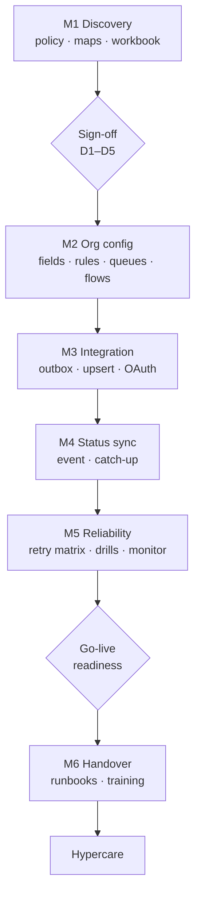
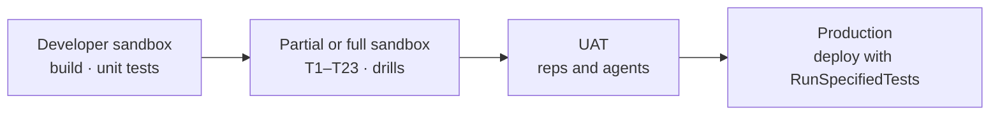

# Consultant Playbook

**How to run Intake-to-Salesforce as a client engagement**

> **Evidence boundary.** This playbook turns the repository's working papers into a delivery method. The workshops, sign-offs, and go-live steps below are **planned**. None has taken place with a client, and the as-is process is a **baseline hypothesis**. Use the playbook to run the next phase, not as a record of one that happened.

---

## 1. Engagement shape

| Phase | Consultant output | Client decision | Repository state |
| --- | --- | --- | --- |
| M1 | Requirements, maps, decision log, workbook | Approve D1–D5. Close the blocking OQs | Written. Approval **pending** |
| M2 | SFDX metadata | Accept configuration | Source. **Not deployed** |
| M3–M5 | Integration and reliability | Accept the test evidence | Python **tested locally** |
| M6 | Admin guide, demo, training | Go-live approval | Written |

## 2. Stakeholder map

| Stakeholder | Interest | Influence | How to engage |
| --- | --- | --- | --- |
| Sales Manager | Clean pipeline, no duplicate pursuit | High: owns D1, D2, L-rules | Decision workshop. Signs D1–D3 |
| Support Lead | Nothing lost, urgent first | High: owns D5, C-rules | Decision workshop. Signs D5 |
| Legal / Privacy | Consent basis, retention | Veto on D3 and D4 | Review session. OQ-02, OQ-03, OQ-16 |
| Salesforce Admin | Deployable, supportable metadata | Medium | Build review. Runbook walkthrough |
| Integration / IT owner | Credentials, hosting, monitoring | Medium | Architecture review. Secrets plan |
| Sales Reps, Support Agents | Usable records and tasks | Low individually, high collectively | UAT and training |
| Engagement sponsor | Outcome and cost | High | Steering checkpoint at each gate |

### 2.1 RACI (from the decision log)

| Step | Customer | AI Intake Agent | Sales Rep | Support Agent | Sales Manager | Support Lead |
| --- | --- | --- | --- | --- | --- | --- |
| Submit request and consent | R, A | C | | | | |
| Assign id and normalize | | R, A | | | | |
| Qualify commercial fit | | R | C | | A | |
| Priority definitions | | R | | C | A (Lead) | A (Case) |
| Ambiguous sales disposition | | C | | | R, A | |
| Work the Lead | | | R | | A | |
| Work the Case | | | | R | | A |
| Unlinked identity and failed support commit | | C | | C | | R, A |

## 3. Discovery workshops

### 3.1 Workshop 1: As-is validation (90 minutes)

**Attendees:** whoever reads the shared mailbox, one Sales Rep, one Support Agent, the Salesforce Admin.

| Time | Activity | Output |
| --- | --- | --- |
| 0:00 | Walk the as-is map lane by lane | Corrections marked on the map |
| 0:25 | "Show me the last five items you rekeyed" | Real examples (redacted) for walkthroughs |
| 0:45 | Duplicate reality check: how often is the sender already a Contact? | Input to R1 and hold volume |
| 1:00 | Channels and volumes | Answers to OQ-01 and OQ-13 |
| 1:15 | Status values in the live org | Answer to OQ-08 |

### 3.2 Workshop 2: To-be decisions (2 hours)

**Attendees:** Sales Manager, Support Lead, Legal (second hour), Admin.

| Time | Walkthrough | Decision tested |
| --- | --- | --- |
| 0:00 | A. Net-new demo request | L8, D1 |
| 0:10 | B. Help from a known person | C1, D3 |
| 0:20 | C. Second email while the Lead is open | L7, D2 |
| 0:30 | D. Urgent outage, two Contacts | C2, D5, BR-23 |
| 0:40 | E. Existing customer asks for pricing only | L4, OQ-05 |
| 0:50 | F. Missing email | BR-03, BR-30 |
| 1:00 | G. Mixed, new logo | BR-17 |
| 1:10 | H. Replay | BR-19 |
| 1:20 | Consent and retention (Legal) | D3, D4, OQ-02, OQ-03, OQ-16 |
| 1:45 | Record decisions in the approval block | Signed D1–D5 or amendments |

Rule for the room: **the decision tables win over the picture.** If a walkthrough produces an outcome the business doesn't want, change the rule in the table, not the drawing.

### 3.3 Discovery questions that change the design

| Question | If the answer is… | Design impact |
| --- | --- | --- |
| Do you use Person Accounts? (OQ-07) | Yes | D1 reopens. Lead versus Person Account replaces Lead versus Contact |
| What are your Lead and Case status values? (OQ-08) | Renamed | Flow decisions and the crosswalk change before deploy |
| What are your Lead and Case org-wide defaults? | Private | Add a sharing rule for the integration user (replay upserts) |
| Is opt-in legally required in your markets? (OQ-02) | No | BR-05 may change. A Lead may be written with another basis |
| Existing customer asking for pricing: hold, Lead, or Opportunity? (OQ-05) | Opportunity | A new write path and permission. Out of current scope |
| Do you already run an integration platform (for example MuleSoft)? | Yes | Keep the contract and host it there ([ARCHITECTURE.md](ARCHITECTURE.md) §8) |
| How many intakes a day, and at peak? (OQ-13) | High | Event allocations, Composite or Bulk API, worker cadence |
| Where should holds and failures live? (OQ-04) | A Salesforce list view | A custom object, designed as its own decision |

## 4. Decision management

| Practice | How |
| --- | --- |
| One decision per ID | D1–D6, each with options considered, consequences, rules, and an owner |
| Status is explicit | Proposed → Accepted, Amended, or Rejected, with name and date in the approval block |
| No silent build | Approving the policy isn't approving the build. Build starts only for slices whose blocking OQs are closed |
| Implementation names are decisions too | D6 records why `Intake_Ref__c` replaced `Intake_Id__c` and why summary moved off Description |
| Rows marked "Not stored" are decisions | Filling them in a workshop reopens D1 or D2 |

## 5. Build governance

### 5.1 Definition of done per slice

| Slice | Done when |
| --- | --- |
| Metadata | Deployed to a sandbox. T1–T23 executed and recorded. Apex test run with coverage reported |
| Integration | 22 local tests green. Smoke test steps 1–7 in [INTEGRATION_GUIDE.md](INTEGRATION_GUIDE.md) §9 green in the sandbox |
| Status sync | One event observed per status change. Catch-up returns both objects. A subscriber restart resumes from its cursor |
| Reliability | Drills repeated against the sandbox where safe (wrong secret, validation failure, duplicate, subscriber down) |

### 5.2 Environment path

Promote with `sf project deploy start --manifest manifest/package.xml`. In production, run `IntakeStatusResourceTest`. External Client App settings and secrets are per environment and never in source control.

## 6. Go-live readiness checklist

| # | Item | Owner | Status in this package |
| ---: | --- | --- | --- |
| 1 | D1–D5 accepted or amended in writing | Sponsor | Pending |
| 2 | OQ-02, OQ-05, OQ-07, OQ-08 closed for the slices going live | Sales Manager, Legal | Open |
| 3 | Live status values match the flows | Admin | Open (OQ-08) |
| 4 | Sharing allows the integration user to update queue-owned intake records | Admin | Not designed in source |
| 5 | Integration user has API Enabled from its profile or licence. Not an admin | Admin | Documented |
| 6 | External Client App with client credentials and run-as user. Secret in a vault | IT | Not created |
| 7 | Queues staffed (members added) | Sales Manager, Support Lead | Not done |
| 8 | Apex test passes in the target org | Admin | Not executed |
| 9 | T1–T23 recorded | QA | Not executed |
| 10 | Worker and subscriber scheduled. Monitor wired to alerting | IT | Not built |
| 11 | Retry matrix handles `403 REQUEST_LIMIT_EXCEEDED` | Integration | Gap G1 |
| 12 | Dead Letter re-queue procedure agreed | Integration, Support Lead | Manual SQL only |
| 12a | Client sends `Sforce-Auto-Assign: FALSE`, or the org has no active Lead or Case assignment rule | Integration, Admin | Gap F26 |
| 12b | Scheduled paths survive ordinary edits (org test T22) | Admin | Gap F27, unverified |
| 13 | Training delivered to reps and agents | Consultant | Not done |
| 14 | Rollback plan: deactivate flows, stop the worker, keep the outbox | Admin, IT | Documented below |

### 6.1 Rollback plan

1. Stop the worker and subscriber schedules. The outbox keeps rows Pending, so no data is lost.
2. Deactivate the four flows if assignment misbehaves. Records stay where they are.
3. Validation rules can stay. They only fire on records with a reference.
4. Fix, redeploy, restart the worker. Pending rows deliver, and the upsert means no duplicates.

## 7. Training plan

| Audience | Format | Content |
| --- | --- | --- |
| Sales Reps | 30-minute session | Inbound Sales queue, the review task, the 24-hour escalation, Qualification Reason when closing as Not Converted, never editing Intake Ref |
| Support Agents | 30-minute session | Support Tier 1, urgent vs standard tasks, 4- and 24-hour monitors, unlinked Cases (don't guess a Contact) |
| Managers | 45-minute session | Holds (when built), queue reports, Dead Letter escalation path |
| Admin | Runbook walkthrough | Deploy, permission set, External Client App, monitor, re-queue |

## 8. Success measures (to baseline, not yet measured)

| Measure | Definition | Source once live |
| --- | --- | --- |
| Rekey rate | Intakes typed by hand into Salesforce | Records without `Intake_Ref__c` from intake channels |
| Duplicate Lead rate | New Leads whose email matches an existing Contact or open Lead | Report (needs normalized email) |
| Time to first touch | `CreatedDate` to the first status change | `Intake_Status__e` history at the agent |
| Escalation rate | Leads escalated at 24 h ÷ intake Leads | Tasks with the escalation subject |
| Urgent response | High Cases still New at 4 h | Monitor tasks |
| Integration health | Dead letters per 1,000 intakes. Retry attempts. Subscriber deferrals | Monitor |

No baseline exists yet. Workshop 1 should capture one. Don't quote improvement percentages before then.

## 9. Communication templates

**Steering update (one paragraph):**

> M2–M5 are built in source and pass 22 local tests. Go-live depends on four open questions (consent basis, known-customer pricing path, Person Accounts, live status values) and on your approval of decisions D1–D5. We also need two org settings confirmed: sharing for the integration user, and an API-enabled integration licence. No production change has been made.

**Customer receipt (per BR-02):**

> We've received your request. Your reference is INT-20261124-0042. Please quote it if you contact us again. We'll be in touch. This message confirms receipt only.

## 10. Lessons to carry into the next engagement

1. **Write the policy before the payload.** The decision log made M2–M5 small, because every hard question was already answered or explicitly open.
2. **Name what isn't built.** The designed-versus-built table in [SOLUTION_DESIGN.md](SOLUTION_DESIGN.md) §10 prevents a demo from over-promising.
3. **Ask about sharing and limits in discovery.** Both gaps found in review (G1, G2) are org settings a single question would have surfaced.
4. **Keep Salesforce the owner of owner and status.** It removed a whole class of replay bugs.
5. **Treat "Not stored" as an answer.** It stopped scope creep into Contact and Account.
