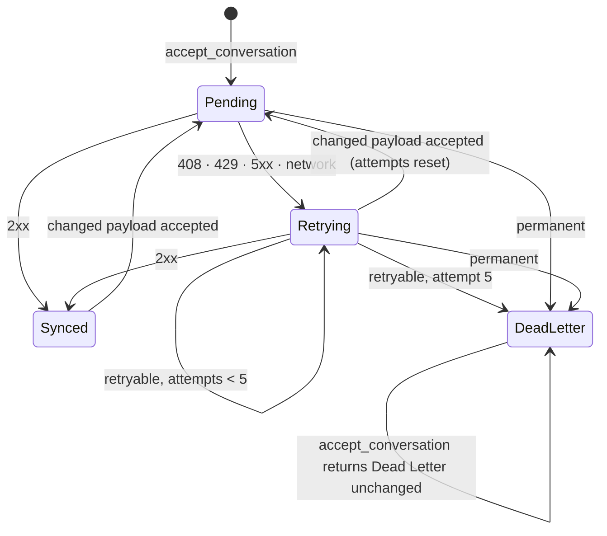
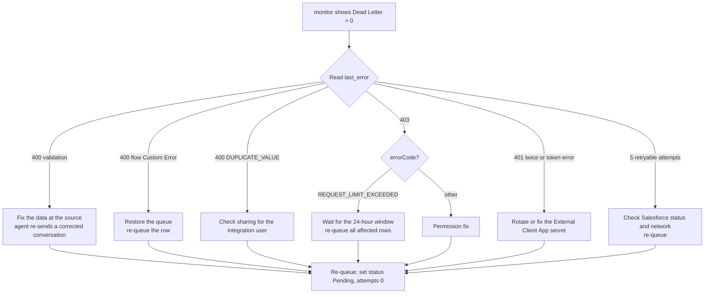

# Error Handling

> **Evidence boundary.** The retry matrix, outbox states, and subscriber deferral are **implemented** and **tested locally** against a stand-in. Salesforce-side errors (validation, flow Custom Error, sharing, limits) are described from the metadata and Salesforce's documented behaviour. They haven't been observed in an org. §6 lists the gaps this review found.

---

## 1. Error taxonomy by layer

| Layer | Error | Raised as | Where it ends |
| --- | --- | --- | --- |
| Producer (agent → outbox) | Bad reference, both or neither intent, blank summary, bad channel, a Lead missing name, company, or email | `RouteError` (synchronous) | Returned to the agent. **Nothing stored** |
| Token endpoint | Wrong secret or another 4xx | `PermanentSalesforceError` | Dead Letter, attempt 1 |
| Token endpoint | 408, 429, 5xx | `RetryableSalesforceError` | Retrying |
| Network | Connection refused, timeout, DNS | `NetworkError` (retryable) | Retrying |
| REST upsert | 401 | Refresh once inside the client | Transparent if the new token works. Otherwise Dead Letter |
| REST upsert | 408, 429, 5xx | `RetryableSalesforceError` with `retry_after` | Retrying, then Dead Letter on attempt 5 |
| REST upsert | Other 4xx, 3xx, unexpected status | `PermanentSalesforceError` | Dead Letter at once |
| Salesforce save | Validation rule, flow Custom Error (missing queue), unique-index collision | HTTP 400 to the client | Dead Letter |
| Subscriber | CometD network failure, 408, 429, 5xx, non-JSON | `CatchUpError` or `NetworkError` | Deferred. Cursor unchanged. Error stored in `sync_health` |
| Subscriber | Replay id rejected | `ReplayExpired` | Apex catch-up, then resume with new events only |
| Catch-up | Network failure, 4xx or 5xx, non-JSON | `CatchUpError` | Deferred. The error is stored |

## 2. Retry matrix (Implemented, tested locally)

`integration/retry_matrix.py`. Seven signals.

| # | Signal | Action | Outbox state | Schedule |
| ---: | --- | --- | --- | --- |
| 1 | 401 on the API | Refresh the access token once | Unchanged if the new token works | One new token request. A second 401 is Dead Letter |
| 2 | 408 | Retry | Retrying | 1, 2, 4, 8 s (cap 60). Dead Letter on attempt 5 |
| 3 | 429 | Back off | Retrying | `Retry-After` when sent, otherwise the 408 schedule |
| 4 | 5xx | Retry | Retrying | Same as 408 |
| 5 | 400 validation (and other 4xx except 401, 408, 429) | Dead Letter | Dead Letter | Immediate |
| 6 | Network failure | Retry | Retrying | Same as 408 |
| 7 | Wrong client secret | Dead Letter | Dead Letter | Token endpoint fails. There's no token to refresh |



### 2.1 Backoff

```python
def backoff_seconds(attempts, retry_after):
    if retry_after is not None and retry_after >= 0:
        return float(retry_after)              # the server's hint wins, uncapped
    return float(min(60, 2 ** (attempts - 1))) # 1, 2, 4, 8 … cap 60
```

| Attempt that failed | Next wait (no header) | Row state |
| ---: | ---: | --- |
| 1 | 1 s | Retrying |
| 2 | 2 s | Retrying |
| 3 | 4 s | Retrying |
| 4 | 8 s | Retrying |
| 5 | n/a | Dead Letter |

A 401 recovered inside the client doesn't increment `attempts`. The outbox never sees it.

### 2.2 What a Dead Letter row holds

| Column | Content |
| --- | --- |
| `intake_ref`, `object_api_name` | Which intake and which object |
| `attempts` | Attempts made, including the failing one |
| `last_error` | First 1,000 characters, for example `HTTP 400: Priority is required when Intake Ref is set.` |
| `payload_json` | The canonical payload that failed |

## 3. Salesforce-side failure modes

| Cause | What Salesforce returns | Matrix result | Correct handling |
| --- | --- | --- | --- |
| Validation rule (format, immutable, summary, channel, priority, reason) | 400 `FIELD_CUSTOM_VALIDATION_EXCEPTION` | Dead Letter | ✓ Permanent until the payload changes |
| `Inbound_Sales` or `Support_Tier_1` missing | 400, flow Custom Error | Dead Letter | ✓ Fix the org, then re-queue |
| Restricted picklist value | 400 `INVALID_OR_NULL_FOR_RESTRICTED_PICKLIST` | Dead Letter | ✓ (the producer also checks the channel) |
| Integration user lacks a field or object | 400 `INVALID_FIELD_FOR_INSERT_UPDATE` or 403 | Dead Letter | ✓ Permission fix |
| Record not visible to the integration user (Private sharing, queue-owned) | Upsert finds no match, tries an insert, gets 400 `DUPLICATE_VALUE` on the unique id | Dead Letter | ✗ Sharing fix needed (§6, G2) |
| Upsert to a converted Lead | 400 (converted Leads can't be updated) | Dead Letter | ◐ Expected, but no reconciliation path (§6, G6) |
| Record locked by another transaction | Typically a 4xx carrying `UNABLE_TO_LOCK_ROW` | Dead Letter | ✗ Should retry (§6, G3) |
| Daily API request limit | **403 `REQUEST_LIMIT_EXCEEDED`** | **Dead Letter** | ✗ Should back off and pause (§6, G1) |
| Instance maintenance or overload | 503 | Retrying | ✓ |
| Expired session | 401 | Refresh once | ✓ |

## 4. Subscriber error handling (Implemented, tested locally)

| Situation | Behaviour | Test or drill |
| --- | --- | --- |
| CometD unreachable | `deferred=True`. The cursor stays where it was. The error is stored in `sync_health`. The next run asks from the same cursor | Drill 6, Subscriber down |
| Replay id expired | Catch-up by known references (or the last 24 h if none are known), then `resume_new`, then read new events | `test_expired_replay_id_uses_catch_up_then_new_events` |
| Duplicate delivery | `seen_replay` hit, counted as a duplicate, not applied | `test_duplicate_replay_id_is_applied_once` |
| Process restart | The SQLite cursor and `seen_replay` survive | `test_restart_from_sqlite_skips_events_already_seen` |
| A successful run after an error | `clear_failure`, so the monitor shows no error | Drill 6 (`error_after=None`) |

## 5. Operator runbook: Dead Letter



**Re-queue is manual today.** No command exists, and `accept_conversation` won't reopen a Dead Letter row even with a corrected payload. Until a `requeue` command is built, an operator would run:

```sql
-- intake_outbox.sqlite. Operator action, after the cause is fixed
UPDATE outbox
SET status = 'Pending', attempts = 0, next_attempt_at = NULL, last_error = NULL
WHERE intake_ref = 'INT-20261124-0013' AND object_api_name = 'Case';
```

This is a documented workaround, not code in the repository.

## 6. Gaps found in review

| ID | Gap | Impact | Recommended change |
| --- | --- | --- | --- |
| **G1** | Salesforce reports the org's API request limit as **HTTP 403 with `errorCode: REQUEST_LIMIT_EXCEEDED`**. The REST error reference doesn't list 429. The "API limit exceeded" drill simulates a 429 with `Retry-After: 30` | In a real limit event every queued row would dead-letter on its first attempt | Parse the error body. Treat `REQUEST_LIMIT_EXCEEDED` as back-off with a long delay (for example 15 minutes, growing). Add a circuit breaker so the worker stops sending while the limit is hit. Keep the 429 rule for gateways that do send it |
| **G2** | Replay upserts need the integration user to **see** the record, but the assignment flow moves ownership to a queue | Under Private OWD, any second delivery (changed payload, manual re-queue) dead-letters with `DUPLICATE_VALUE` | Criteria-based sharing rule on `Intake_Ref__c` to the integration user's group (Read/Write), or confirm Public Read/Write OWD. Add smoke-test step 7 |
| **G3** | Transient conditions that Salesforce reports inside a 4xx body (for example `UNABLE_TO_LOCK_ROW`) are permanent under a status-only matrix | Spurious dead letters under contention | Classify by `errorCode` as well as status |
| **G4** | Dead Letter rows can't be re-queued, even with a corrected payload | US-10 AC4 can't be met without manual SQL | Add `python -m integration.outbox --requeue REF OBJECT`, and let `accept_conversation` reopen Dead Letter when the payload changed |
| **G5** | `RouteError` reasons aren't persisted | BR-30 "reason remains visible" relies on the agent | Store rejected intakes in a `rejected` table, or return a structured reason the agent must record |
| **G6** | Converted Leads reject updates | A late replay for a converted Lead dead-letters | Treat a converted-Lead error as terminal-success with a note, and map `Intake_Ref__c` on conversion |
| **G7** | `Retry-After` is honoured without a ceiling | A large header value parks a row indefinitely | Cap it (for example one hour) and log the original |
| **G8** | No alerting | Dead letters are visible only when someone runs the monitor | Ship monitor output to the client's alerting. Alert on Dead Letter > 0 or a stale subscriber error |
| **G9** | Flow DML (task creates) has no fault path | A task failure rolls back the whole upsert, which then dead-letters | Acceptable as strict behaviour. Otherwise add fault paths that log and continue |

## 7. Recommended matrix v2 (design, not built)

| Signal | Action | Schedule |
| --- | --- | --- |
| 2xx | Synced | n/a |
| 401 | Refresh once, then Dead Letter | n/a |
| 403 + `REQUEST_LIMIT_EXCEEDED` | **Pause the worker** (circuit open), keep rows Retrying | 15 min, 30 min, 60 min, then hourly. Doesn't consume attempts |
| 403, other | Dead Letter | n/a |
| 400 + `UNABLE_TO_LOCK_ROW` | Retry | 1, 2, 4, 8 s |
| 400, other | Dead Letter | n/a |
| 408, 5xx, network | Retry | 1, 2, 4, 8 s, cap 60. Dead Letter on attempt 5 |
| 429 | Back off | `Retry-After` capped at one hour, else the 408 schedule |
| Wrong secret | Dead Letter and alert | n/a |
