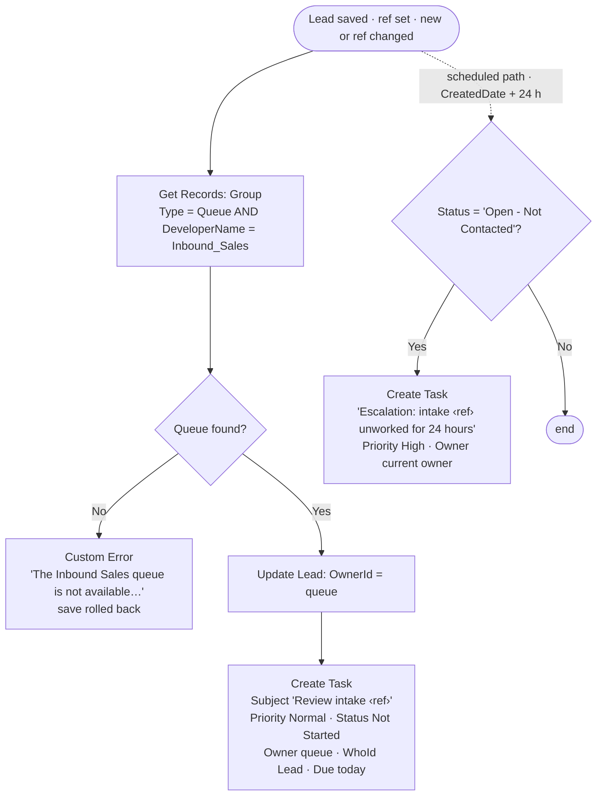
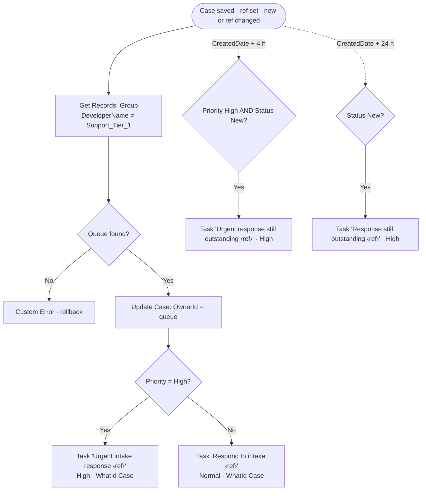
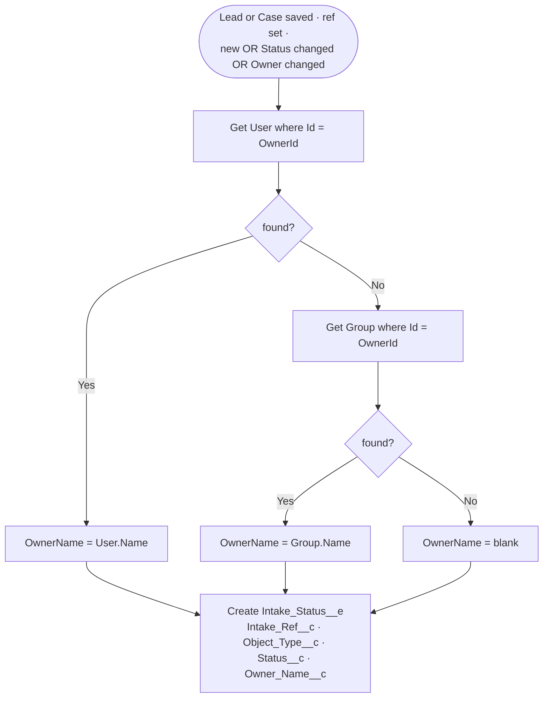

# Flow Design

> **Evidence boundary.** The four record-triggered flows are **implemented** as active metadata (API 62.0) and were checked statically: the XML is well formed and the elements are present. They have **not been deployed or run**. Org tests T1–T17 from the repository and T18–T23 added in this review are written and **not executed**. The SVG diagrams in `docs/flow-screenshots/` are drawn from the metadata, not captured in Flow Builder.

---

## 1. Inventory

| Flow | Object | Trigger | Order | Entry condition (formula) | Scheduled paths |
| --- | --- | --- | ---: | --- | --- |
| `Lead_Intake_Handling` | Lead | After save, create and update | 10 | `AND(NOT(ISBLANK(Intake_Ref__c)), OR(ISNEW(), ISCHANGED(Intake_Ref__c)))` | 24 h after `CreatedDate` |
| `Case_Intake_Handling` | Case | After save, create and update | 10 | Same | 4 h and 24 h after `CreatedDate` |
| `Lead_Status_Publisher` | Lead | After save, create and update | 20 | `AND(NOT(ISBLANK(Intake_Ref__c)), OR(ISNEW(), ISCHANGED(Status), ISCHANGED(OwnerId)))` | none |
| `Case_Status_Publisher` | Case | After save, create and update | 20 | Same | none |

All four are `AutoLaunchedFlow`, status Active, and run in system context. There are no Apex triggers in the project.

### 1.1 Why these flow choices

| Choice | Reason |
| --- | --- |
| **After save**, not before save | Assignment creates related Tasks and publishes an event. Before-save flows can only change fields on the triggering record |
| **Formula entry conditions** | `ISNEW()` and `ISCHANGED()` stop replays and ordinary edits from re-running assignment |
| **Trigger order 10 and 20** | Assignment runs before publishing, so the publisher sees the queue-owner change |
| **Queue by `DeveloperName`** | Survives a label rename. No hard-coded Id between orgs |
| **Custom Error when the queue is missing** | Rolls back the save rather than leaving the record on the integration user |
| **Tasks for escalation**, not field updates | Escalation is visible work with an owner, and never rewrites Status, Rating, or the reference |
| **Scheduled paths from `CreatedDate`** | Clock starts when the intake arrived, not when it was last edited |

## 2. Lead_Intake_Handling

| Element | Type | Detail |
| --- | --- | --- |
| `Get_Inbound_Sales_Queue` | Get Records | `Group` where `Type = Queue` and `DeveloperName = Inbound_Sales` |
| `Queue_Found` | Decision | Id is not null |
| `Inbound_Sales_Queue_Missing` | Custom Error | Page-level message. Rolls back the transaction |
| `Assign_To_Inbound_Sales` | Update Records | `OwnerId` |
| `Create_Review_Task` | Create Records | `ReviewTaskSubject`, `ReviewTaskDescription` ("Channel: … Read Intake Summary on the lead. Do not replace Intake Ref.") |
| `Still_Unworked` | Decision | `$Record.Status = 'Open - Not Contacted'` |
| `Create_Escalation_Task` | Create Records | High priority, owner `$Record.OwnerId` |

## 3. Case_Intake_Handling

| Element | Detail |
| --- | --- |
| One queue for all priorities | Decision D6. Priority changes the task and the clock, not the queue |
| Task relation | `WhatId` = Case, so no Contact is needed (Cases may be unlinked) |
| 4-hour monitor | Only High and still New |
| 24-hour monitor | Any intake Case still New |
| Both clocks | A High Case still New at 4 h and at 24 h gets both tasks. A Case that has left New gets neither. Both assume the paths weren't cancelled by an earlier edit (§8, F27) |

## 4. Status publishers

`Object_Type__c` is a literal (`Lead` or `Case`) in each flow. The event is Publish After Commit, so a rolled-back save publishes nothing. Detail: [PLATFORM_EVENTS.md](PLATFORM_EVENTS.md).

## 5. Interaction with the integration

| Integration action | Flow behaviour |
| --- | --- |
| First upsert (insert) | Assignment runs: queue and task. Publisher runs for the insert and again for the owner change |
| Replay with the same payload | Never sent (outbox) |
| Upsert with a changed summary | Assignment doesn't run (reference unchanged). Publisher doesn't run (status and owner unchanged) |
| Rep changes Status | Publisher runs. The agent receives the new status |
| Rep reassigns to a user | Publisher runs with the user's name |
| Queue deleted in the org | Insert fails with the Custom Error (400). The outbox dead-letters with that message |
| A task insert fails | No fault path, so the whole save rolls back, and the outbox dead-letters with the flow error |

## 6. Validation rules (run before the flows)

| Object | Rule | Fires when |
| --- | --- | --- |
| Lead, Case | `Intake_Ref_Format` | Reference set and not `^INT-[0-9]{8}-[0-9]{4}$` |
| Lead, Case | `Intake_Ref_Immutable` | Not new, reference changed, prior value not blank (blocks change **and** clearing) |
| Lead, Case | `Intake_Summary_Required` | Reference set and summary blank |
| Lead, Case | `Intake_Channel_Required` | Reference set and channel blank |
| Lead | `Qualification_Reason_Required` | Reference set, Status is Closed - Not Converted, reason blank |
| Case | `Intake_Priority_Required` | Reference set and Priority blank |

Every rule is conditional on `Intake_Ref__c`, so Leads and Cases created outside intake are unaffected (T8).

## 7. Org test plan (not executed)

Run in a sandbox, as a user with Minimum Access plus `Intake_Integration`, after confirming the Lead status `Open - Not Contacted` and Case status `New` exist.

| ID | Check | Expected |
| --- | --- | --- |
| T1 | Insert an intake Lead | Owner is Inbound Sales |
| T2 | Same save | One task `Review intake {ref}`, Normal, owned by the queue |
| T3 | Edit the email | Still one review task. Owner unchanged |
| T4 | Bad reference, blank summary, blank channel | Each rejected with a field message |
| T5 | Second Lead, same reference | Rejected by the unique index |
| T6 | Case with the same reference | Saves. Uniqueness is per object |
| T7 | Change the Lead's reference | Rejected (immutable) |
| T8 | Ordinary Lead with no intake fields | Saves. No queue change, no intake validation |
| T9 | The T6 Case | Owner is Support Tier 1 |
| T10 | Medium task, then a High Case | Normal "Respond to intake". High "Urgent intake response", same queue |
| T11 | Intake Case with no Priority | Rejected |
| T12 | Close the Lead as Not Converted with no reason, then with one | Rejected, then saved |
| T13 | Leave a Lead Open - Not Contacted for 24 h | High escalation task, current owner |
| T14 | Move a Lead to Working - Contacted before 24 h | No escalation |
| T15 | High Case left New | Tasks at 4 h and at 24 h |
| T16 | Move Cases off New before their clocks | No monitoring tasks |
| T17 | Least privilege | Create and edit succeed. Delete denied. No View All, Modify All, API Enabled, or Apex in the set |

T13–T16 wait on real time. Prove the paths on a sandbox copy with shortened offsets, then restore 24 h and 4 h. Never shorten the offsets in production.

### 7.1 Tests added in review

| ID | Check | Expected |
| --- | --- | --- |
| T18 | Count `Intake_Status__e` events for one new intake Lead | Record the number (expected 2: insert, then owner change) |
| T19 | Re-upsert a changed summary as the integration user after queue assignment | 200 or 204. Proves sharing lets the upsert find the record |
| T20 | Delete or rename `Support_Tier_1`'s DeveloperName, then upsert a Case | 400 with the Custom Error text. Outbox Dead Letter shows it |
| T21 | Convert an intake Lead, then upsert it again | Record the error, and decide reconciliation (finding F12) |
| T22 | Insert an intake Lead and an intake High Case. Edit a non-status field on each (for example Phone or Subject) before the clock. Use shortened offsets on a sandbox copy | Escalation and monitoring tasks still arrive. If they don't, the scheduled paths were cancelled (finding F27) |
| T23 | With an active Lead assignment rule in the sandbox, upsert a changed summary for a Lead a rep owns | Owner unchanged. Proves `Sforce-Auto-Assign: FALSE` is sent (finding F26) |

## 8. Design considerations and gaps

| Topic | Observation | Recommendation |
| --- | --- | --- |
| **Scheduled-path cancellation (F27)** | Salesforce documents that when an update makes a record stop meeting a flow's entry conditions, the flow's pending scheduled paths are cancelled. The scheduled paths here share the entry formula `ISNEW() OR ISCHANGED(Intake_Ref__c)`, which is false on every later save. The first ordinary edit (and possibly the flow's own `OwnerId` update) could therefore cancel the 24-hour escalation and the Case clocks. Unverified until T22 runs | Move the scheduled paths into a separate flow per object whose condition stays true for the record's life (`Intake_Ref__c` is not blank), set to run only when a record is updated to meet the condition. Keep the Status checks inside the paths. Keep assignment on the current formula |
| Hard-coded status strings | `Open - Not Contacted` and `New` are literals (OQ-08) | Confirm live values before deploy. Consider a custom metadata or custom label for the value |
| No fault connectors | A task-create failure rolls back the business record | Keep it strict, or add fault paths that log to a platform event or an error object and continue |
| Scheduled-path volume | Each intake arms 1 (Lead) or 2 (Case) scheduled interviews | Fine at intake volumes. Check the org's scheduled-path limits once OQ-13 gives volumes |
| Owner on scheduled tasks | `$Record.OwnerId` at run time, which may be a queue (queues accept Task) | As designed. Queue members see the escalation |
| Lead conversion | Converting sets a closed status, which can trigger the publisher if the org runs automation on convert | Decide whether the agent should hear "Closed - Converted", and map `Intake_Ref__c` on conversion |
| Re-tagging an existing record | Setting a reference on an old record starts a new interview, and the scheduled paths fire almost at once because `CreatedDate` is old | Intended: a late-tagged record is still checked |
| Static check note | `docs/flow-design.md` §5 says the project has "no Apex classes, no Platform Event definitions", which was true at M2 and is stale after M4 | Update the working paper |
