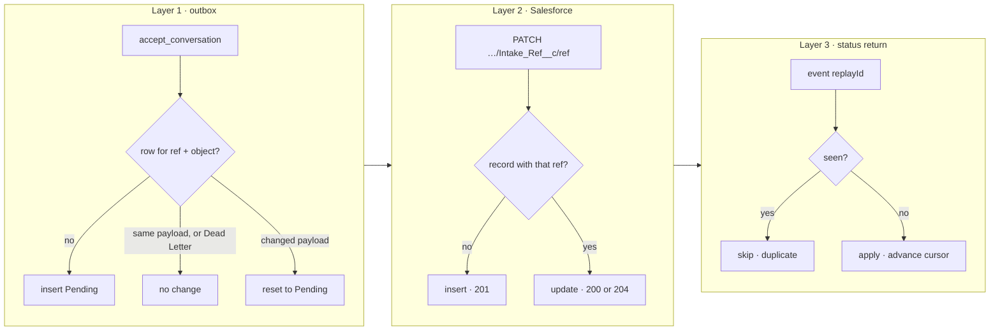

# Idempotency

> **Evidence boundary.** All three idempotency layers are **implemented**. The outbox and replay-id layers are **tested locally**. The Salesforce layer is exercised against an HTTP stand-in that imitates upsert semantics. The real org behaviour, including sharing (§6), hasn't been observed.

**Guarantee:** delivering the same intake any number of times, over any number of crashes, retries, or duplicate events, leaves **one Lead or one Case per reference per object**, and one status row per reference per object at the agent.

---

## 1. Three layers



| Layer | Key | Mechanism | Test |
| --- | --- | --- | --- |
| 1 · Outbox | `(intake_ref, object_api_name)` | SQLite `UNIQUE` constraint plus canonical JSON comparison | `test_twenty_conversations_route_and_replay_without_duplicates` |
| 2 · Salesforce | `Intake_Ref__c` per object | Unique, case-insensitive external id. Upsert by URL | `test_oauth_and_twenty_conversations_replay_to_one_record_each`, `test_same_external_id_is_updated_in_place` |
| 3 · Status | `(channel, replay_id)` | `seen_replay` primary key. Cursor stored with each apply | `test_duplicate_replay_id_is_applied_once`, `test_restart_from_sqlite_skips_events_already_seen` |

## 2. Layer 1: the outbox

### 2.1 The key

```sql
CREATE TABLE outbox (
  id INTEGER PRIMARY KEY AUTOINCREMENT,
  intake_ref TEXT NOT NULL,
  object_api_name TEXT NOT NULL,
  payload_json TEXT NOT NULL,     -- canonical: sort_keys, compact separators
  status TEXT NOT NULL,           -- Pending | Retrying | Synced | Dead Letter
  attempts INTEGER NOT NULL DEFAULT 0,
  next_attempt_at TEXT,
  last_error TEXT,
  created_at TEXT NOT NULL,
  updated_at TEXT NOT NULL,
  UNIQUE (intake_ref, object_api_name)
);
```

The key is the business identity of the write: which intake and which object. It isn't a message id. Two deliveries of the same conversation can't produce two rows.

### 2.2 Accept rules

| Existing row | Incoming payload | Result |
| --- | --- | --- |
| None | Any valid | Insert, Pending |
| Any status | Byte-identical canonical JSON | No change. Returns the current status |
| Dead Letter | Different | No change. Returns Dead Letter (gap G4 in [ERROR_HANDLING.md](ERROR_HANDLING.md)) |
| Pending, Retrying, or Synced | Different | Replace the payload. Reset to Pending with attempts 0 |

Canonical JSON (`json.dumps(payload, sort_keys=True, separators=(",", ":"))`) makes the comparison independent of key order and whitespace.

### 2.3 A durable outbox, not a strict transactional outbox

In the strict *transactional outbox* pattern, the producer writes its business state and the outbox row in **one database transaction**. Here the intake agent's state lives upstream and only the outbox lives in SQLite, so this is a **durable outbox**. If the agent crashes after deciding but before calling `accept_conversation`, the intake isn't queued. Layer 1 makes re-sending safe, so the agent can resend on restart. A production design would co-locate the agent's state and the outbox, or make the agent's hand-off at-least-once.

## 3. Layer 2: the external-id upsert

```http
PATCH /services/data/v62.0/sobjects/Case/Intake_Ref__c/INT-20261124-0012
```

| Property | Why it matters |
| --- | --- |
| `externalId = true` | Indexed, and enables upsert by URL |
| `unique = true` | The database refuses a second record with the same reference on that object |
| `caseSensitive = false` | `int-20261124-0012` and `INT-20261124-0012` are the same key |
| Per-object uniqueness | One Lead and one Case may share a reference (a Mixed intake, by design). Two Leads can't |
| Immutable once set (validation) | The key can't drift after creation |
| Format validation | The key is always `INT-YYYYMMDD-####` |

### 3.1 Payload discipline

| Omitted field | Replay hazard it prevents |
| --- | --- |
| `OwnerId` | A replay pulling the record off the queue the flow assigned |
| `Status` | A replay moving a worked record back to its create status |
| `Intake_Ref__c` in the body | Conflicting key values. The URL is the single source |

Omitting `OwnerId` protects the owner from the payload, but not from the org's own assignment rules. The REST API applies an active Lead or Case assignment rule on creates and updates unless the request sends `Sforce-Auto-Assign: FALSE`, and the client doesn't send it (finding F26). Add the header so a changed-payload update can't reassign a worked record.

A replay of an *unchanged* payload doesn't reach Salesforce at all (layer 1). A *changed* payload updates only intake fields. Because `Intake_Ref__c` doesn't change, the assignment flow's entry condition (`ISNEW() OR ISCHANGED(Intake_Ref__c)`) is false, so the queue and the review task aren't duplicated.

### 3.2 Automation idempotency

| Flow | Guard | Effect on replay |
| --- | --- | --- |
| Assignment (order 10) | New, or reference changed | No second task, no re-assignment |
| Publisher (order 20) | New, status changed, or owner changed | No event for a field-only update |

## 4. Layer 3: status return

| Mechanism | Detail |
| --- | --- |
| Replay cursor | `replay_cursor(channel, replay_id, resume_new)`. The cursor is advanced in the same SQLite transaction as the apply |
| Seen set | `seen_replay(channel, replay_id)` primary key. A redelivered id is counted as a duplicate |
| State shape | `intake_status(intake_ref, object_type)` primary key. The latest event wins (events arrive in replay order) |
| Catch-up writes | `apply_snapshot` upserts the same row with `source='catchup'` |

The three writes (status row, seen id, cursor) commit together, so a crash can't apply an event without recording it as seen.

## 5. End-to-end proof (tested locally)

| Scenario | Result |
| --- | --- |
| 20 conversations accepted, delivered, accepted again, and delivered again | 20 outbox rows, 10 Leads + 10 Cases in the stand-in, replay processes 0 rows |
| Duplicate submission drill | `rows=1 records=1 replay=Synced replay_processed=0` |
| Retryable failure, then success | One record |
| Changed summary for a Synced reference | Same external id updated. Still one record |
| Same replay id delivered twice | Applied once, one duplicate counted |
| Restart from SQLite | Events at or before the cursor skipped |

## 6. Where idempotency depends on configuration

**Sharing and the upsert match.** The REST upsert looks up the external id **as the integration user**. After `Lead_Intake_Handling` or `Case_Intake_Handling` sets `OwnerId` to a queue, the integration user is no longer the owner, and the permission set deliberately grants no View All. If Lead or Case org-wide defaults are **Private**:

1. A second delivery (a changed payload, or a manual re-queue) can't see the existing record.
2. Salesforce treats the upsert as an insert.
3. The unique index rejects it with `DUPLICATE_VALUE` (400).
4. The row dead-letters.

The duplicate is still prevented, so idempotency holds, but the **update is lost**. The repository already solved the same visibility problem for reads (`IntakeStatusResource` is `without sharing`). The write path needs one of:

| Option | Trade-off |
| --- | --- |
| Criteria-based sharing rule: `Intake_Ref__c` not blank → Read/Write to a public group containing the integration user | **Recommended.** Narrow, declarative, auditable |
| Public Read/Write OWD on Lead and Case (often the default in new orgs) | Works, but is an org-wide decision |
| View All or Modify All on the permission set | Too broad. Contradicts least privilege |
| An Apex REST write endpoint `without sharing` | More code. Moves validation into Apex |

## 7. What idempotency doesn't cover

| Not covered | Why |
| --- | --- |
| Two *different* references for the same person | That's duplicate *matching* (D2, BR-08), which is designed but not built |
| A Mixed intake writing both a Lead and a Case | `classify` rejects Mixed. The keys already allow it |
| Concurrent workers | The worker has no row claim. Two workers could send the same row twice. Layer 2 makes that harmless, but attempt counts can be off. Run one worker, or add `UPDATE … WHERE status IN (…) RETURNING` claiming |
| Unbounded `seen_replay` growth | No pruning. Rows older than the 72-hour retention window could be deleted safely |
