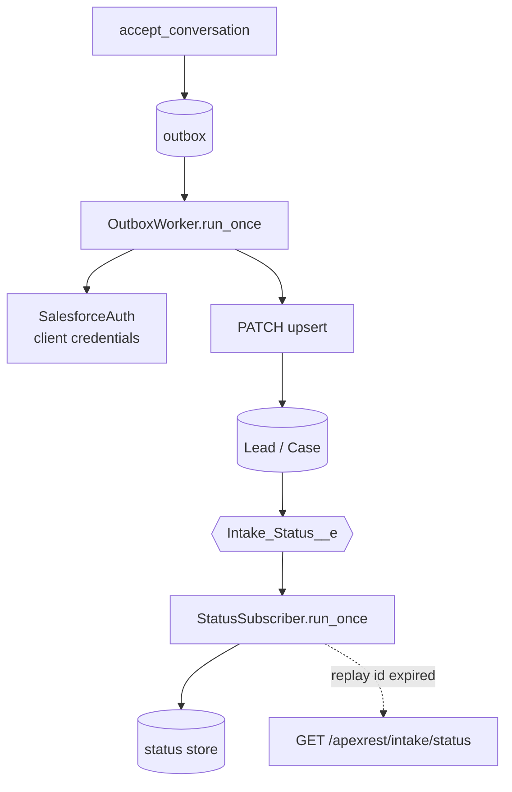
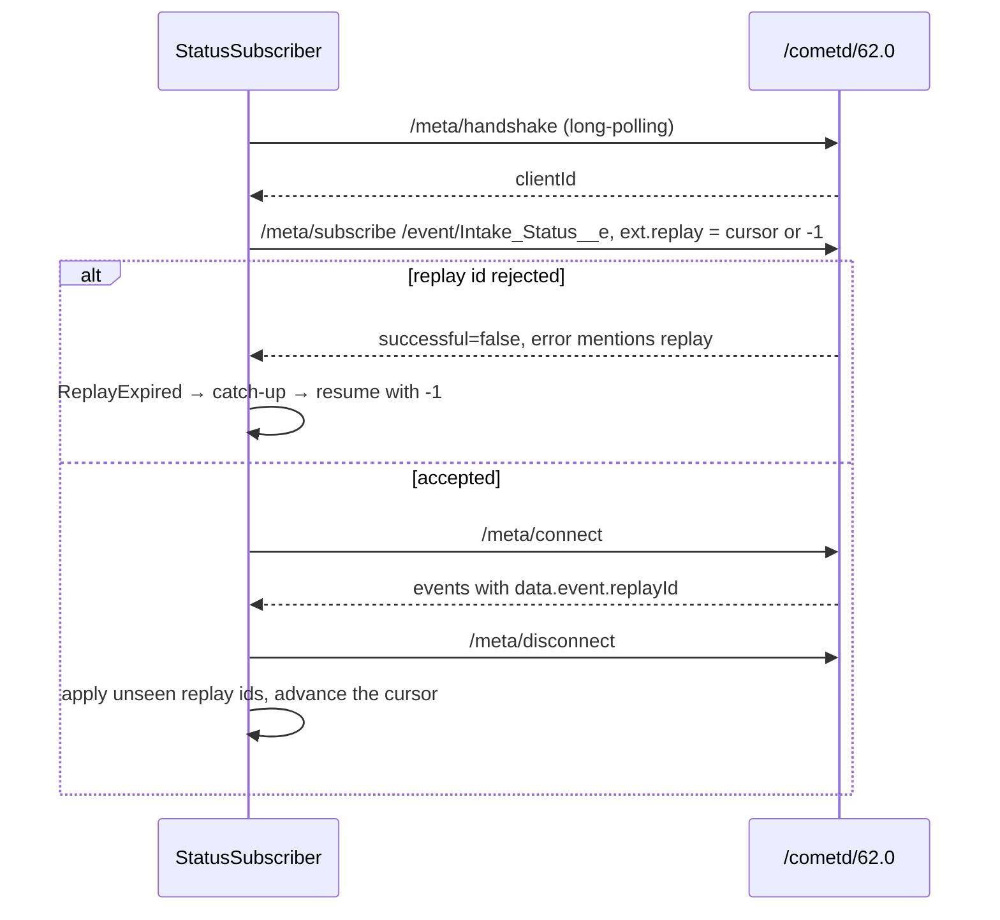

# Integration Guide

> **Evidence boundary.** Every step below is **implemented** in source. The Python side is **tested locally** against stand-ins. The org-side steps (External Client App, integration user, deploy) have **not been performed**. Commands are the ones to use when an org is authorized.

---

## 1. Integration at a glance

| Property | Value |
| --- | --- |
| Direction | Intake → Salesforce (write). Salesforce → intake (status) |
| Pattern | Durable outbox, then idempotent REST upsert. Event-driven status. REST catch-up |
| Auth | OAuth 2.0 client credentials through an External Client App |
| Write API | REST `PATCH /services/data/v62.0/sobjects/{Lead\|Case}/Intake_Ref__c/{ref}` |
| Read-back | CometD Streaming `/cometd/62.0`, channel `/event/Intake_Status__e` |
| Catch-up API | Apex REST `GET /services/apexrest/intake/status?refs=…&since=…` |
| Runtime | Python 3.11+, standard library only (`urllib`, `sqlite3`, `json`) |
| State | `intake_outbox.sqlite`, `intake_status.sqlite` |



## 2. Org setup (to perform once an org is authorized)

| # | Step | Detail |
| ---: | --- | --- |
| 1 | Confirm status values | Lead `Open - Not Contacted` and Case `New` must exist (OQ-08), or the scheduled paths never fire |
| 2 | Confirm sharing | Lead and Case org-wide defaults. With **Private**, add a criteria-based sharing rule (`Intake_Ref__c` not blank → Read/Write to a group holding the integration user) so replay upserts can find queue-owned records |
| 3 | Deploy | `sf project deploy start --manifest manifest/package.xml` |
| 4 | Create the integration user | Dedicated user with **API Enabled** from its profile. The *Salesforce Integration* user licence with *Minimum Access – API Only Integrations* is the least-privilege fit. Not a System Administrator |
| 5 | Assign `Intake_Integration` | Create, read, and edit on Lead and Case, read on `Intake_Status__e`, Apex class access to `IntakeStatusResource` |
| 6 | Create the External Client App | Enable OAuth, enable the **client credentials flow**, set the **run-as user** to the integration user, scope `api`. Policies: restrict IP ranges if the worker has fixed egress |
| 7 | Store credentials | Consumer key and secret in the runtime's secret store. Never in the repository |
| 8 | Run the Apex test | `IntakeStatusResourceTest`, 2 methods (**not executed** in this package) |
| 9 | Run org tests | T1–T23 in [FLOW_DESIGN.md](FLOW_DESIGN.md) (T1–T17 from the repository, T18–T23 added in review) |

## 3. Authentication

### 3.1 Token request

```http
POST {SF_TOKEN_URL}                       # https://<my-domain>.my.salesforce.com/services/oauth2/token
Content-Type: application/x-www-form-urlencoded

grant_type=client_credentials&client_id={SF_CLIENT_ID}&client_secret={SF_CLIENT_SECRET}
```

The response must contain `access_token` and `instance_url`. `expires_in` is used when present. Otherwise the code assumes 3,600 seconds, and the 401-refresh path covers any mismatch with the org's real session timeout.

### 3.2 Caching and refresh

| Rule | Code |
| --- | --- |
| Reuse the token until 60 s before the assumed expiry | `SalesforceAuth.get_access_token` |
| On an API 401, invalidate and retry the call once | `SalesforceClient._upsert_once(allow_refresh=True)` |
| A second 401 is permanent | Dead Letter |
| The token endpoint rejects the secret | Dead Letter on attempt 1, with no PATCH sent |
| Token endpoint 408, 429, 5xx, or network failure | Retryable, same schedule as the API |

The secret and token live in memory only. They're never written to the outbox, logs, or stdout.

### 3.3 Environment

| Variable | Required | Default |
| --- | --- | --- |
| `SF_CLIENT_ID` | Yes | n/a |
| `SF_CLIENT_SECRET` | Yes | n/a |
| `SF_TOKEN_URL` | Yes | n/a |
| `SF_API_VERSION` | No | `62.0` |
| `INTAKE_OUTBOX_PATH` | No | `intake_outbox.sqlite` |
| `INTAKE_STATUS_PATH` | No | `intake_status.sqlite` |

## 4. Producer contract: `accept_conversation`

The intake agent hands over a finished conversation as a mapping:

```python
{
  "intake_ref": "INT-20261124-0001",       # required, INT-YYYYMMDD-####
  "channel":    "Email",                   # required: Web, Email, Chat, or Phone
  "name":       "Jordan Lee",              # Lead: required. Case: optional
  "email":      "jordan.lee@example.com",  # Lead: required. Case: optional
  "company":    "Northline Analytics",     # Lead: required. Case: optional
  "summary":    "We need pricing for 40 seats of the analytics workspace.",  # required
  "transcript": "This is a sales inquiry. …",  # used for routing
  "priority":   "Medium"                   # Case: High, Medium, or Low. Optional
}
```

| Check | Failure |
| --- | --- |
| Reference is 17 characters, `INT-`, 8 digits, `-`, 4 digits | `RouteError`. Nothing stored |
| Transcript contains exactly one of "sales inquiry" or "support request" (case-insensitive) | `RouteError`. Nothing stored |
| Summary non-blank after whitespace collapse | `RouteError` |
| Channel in the four values | `RouteError` |
| Lead: last name, company, and email present | `RouteError` |

`RouteError` is synchronous, so the agent knows at once that nothing was queued and can ask the customer for what is missing.

## 5. Write contract: the upsert

### 5.1 Request

```http
PATCH {instance_url}/services/data/v62.0/sobjects/Lead/Intake_Ref__c/INT-20261124-0001
Authorization: Bearer {token}
Content-Type: application/json

{"FirstName":"Jordan","LastName":"Lee","Company":"Northline Analytics",
 "Email":"jordan.lee@example.com","Intake_Summary__c":"We need pricing for 40 seats of the analytics workspace.",
 "Intake_Channel__c":"Email"}
```

The reference is on the URL and not in the body. `Status` and `OwnerId` are never sent.

> **Add before go-live (finding F26).** The REST API runs the org's active Lead or Case assignment rule on creates and updates unless the request sends `Sforce-Auto-Assign: FALSE`. Salesforce documents the default as `TRUE` when the header is missing. `sf_client.py` doesn't send it today. In an org with an active assignment rule, a changed-payload update could reassign a record a rep is already working, even though `OwnerId` isn't in the payload. Send `Sforce-Auto-Assign: FALSE` on every upsert, because the intake flows own queue assignment.

### 5.2 Payload by object

| Lead field | Source | Case field | Source |
| --- | --- | --- | --- |
| `FirstName` | Name before the first space. Omitted for a single token | `Subject` | Summary, at most 120 characters, ellipsis if cut |
| `LastName` | Rest of the name | `Priority` | `priority` input (title-cased) if High, Medium, or Low. Else "urgent", "outage", or "critical" in the transcript gives High. Else Medium |
| `Company` | Whitespace collapsed | `Intake_Summary__c` | Summary, whitespace collapsed |
| `Email` | Trimmed | `Intake_Channel__c` | Channel |
| `Intake_Summary__c` | Summary | `SuppliedEmail` | If present |
| `Intake_Channel__c` | Channel | `SuppliedName`, `SuppliedCompany` | If present |

Field-by-field contract: [FIELD_MAPPING_GUIDE.md](FIELD_MAPPING_GUIDE.md).

### 5.3 Responses

| HTTP | Meaning | Worker result |
| --- | --- | --- |
| 201 | Created | Synced |
| 200 or 204 | Updated an existing record with that reference | Synced |
| 300 | More than one record matched the external id (shouldn't happen with a unique field) | Dead Letter |
| 400 | Validation, flow Custom Error, duplicate value, and so on | Dead Letter |
| 401 | Token expired or invalid | Refresh once, then Dead Letter |
| 403 | Permission, or `REQUEST_LIMIT_EXCEEDED` | Dead Letter (see [ERROR_HANDLING.md](ERROR_HANDLING.md) §6) |
| 408, 429, 5xx | Transient | Retrying |

## 6. Consumer contract: status events

### 6.1 Event shape

| Field | Type | Example |
| --- | --- | --- |
| `Intake_Ref__c` | Text(40) | `INT-20261124-0001` |
| `Object_Type__c` | Text(40) | `Lead` or `Case` |
| `Status__c` | Text(255) | `Open - Not Contacted` |
| `Owner_Name__c` | Text(255) | `Inbound Sales` (queue) or a user's name |

### 6.2 Subscription cycle (one batch per call)



Run one batch:

```bash
python -c "from integration.sf_auth import SalesforceAuth; \
from integration.subscriber import SalesforceCatchUp, SalesforceEventSource, StatusStore, StatusSubscriber; \
a = SalesforceAuth.from_env(); s = StatusStore(); \
print(StatusSubscriber(s, SalesforceEventSource(a), SalesforceCatchUp(a)).run_once()); s.close()"
```

The subscriber is a one-shot command. In production, a scheduler runs it on an interval shorter than the 72-hour event retention, or it's replaced by a long-lived Pub/Sub API client.

## 7. Catch-up contract: Apex REST

```http
GET {instance_url}/services/apexrest/intake/status?refs=INT-20261124-0001,INT-20261124-0011
GET {instance_url}/services/apexrest/intake/status?since=2026-11-23T12:00:00Z
```

| Parameter | Rule |
| --- | --- |
| `refs` | Comma-separated. At most 200, otherwise 400 |
| `since` | ISO-8601 UTC. Compared with `LastModifiedDate`. Bad format gives 400 |
| Both | AND: references modified since the time |
| Neither | 400 `Provide refs or since` |

```json
[
  {"intakeRef":"INT-20261124-0001","objectType":"Lead","status":"Working - Contacted","ownerName":"Inbound Sales"},
  {"intakeRef":"INT-20261124-0011","objectType":"Case","status":"New","ownerName":"Support Tier 1"}
]
```

Each object is capped at 200 rows (`LIMIT 200`). The `since`-only form has no ordering or continuation token. See [PLATFORM_EVENTS.md](PLATFORM_EVENTS.md) §7.

## 8. Operating the integration

| Task | Command | Output |
| --- | --- | --- |
| Deliver ready rows once | `python -m integration.outbox` | `processed=… synced=… retrying=… dead_letter=…` |
| Read one status batch | §6.2 | `SyncStats(applied, duplicates, caught_up, replay_expired, deferred, error)` |
| Inspect health | `python -m integration.monitor` | Pending, Retrying, Synced, Dead Letter, retry attempts, status rows, replay cursor, subscriber error, each dead letter |
| Reset local state | Delete the SQLite file | **Drops the cursor and the outbox history.** Do it only on purpose |

Suggested production cadence (design, not built): worker every minute, subscriber every minute, monitor shipped to alerting, with alerts on Dead Letter > 0, Retrying older than 15 minutes, or a subscriber error older than one run.

## 9. Post-deploy smoke test

From [docs/admin-guide.md](docs/admin-guide.md) §8. **Not executed.**

1. Deliver one sales and one support sample. The Lead is owned by Inbound Sales with a review task. The Case is owned by Support Tier 1 with a priority task.
2. Deliver the same samples again. There is no second Lead or Case.
3. Change the Lead status. An `Intake_Status__e` arrives with the new status and the owner name.
4. `GET /services/apexrest/intake/status?refs=INT-20261124-0001` returns the Lead.
5. A bad reference format, or a cleared reference, fails validation.
6. Closing an intake Lead as Closed - Not Converted without a Qualification Reason fails validation.
7. *(Added in review)* Change the Lead's company in the outbox payload and deliver again **after** queue assignment. The update succeeds. This proves the integration user can see the queue-owned record.
