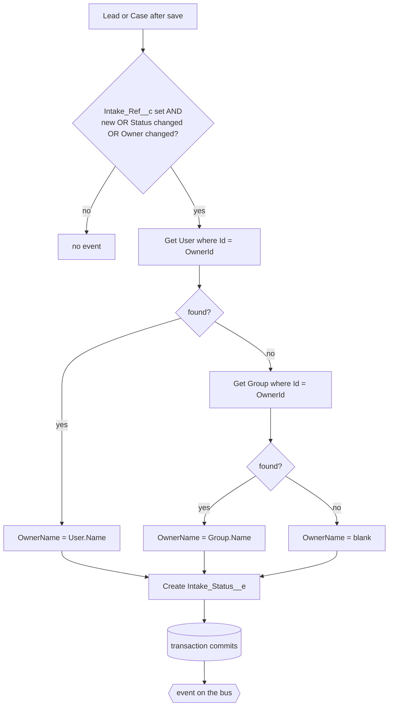
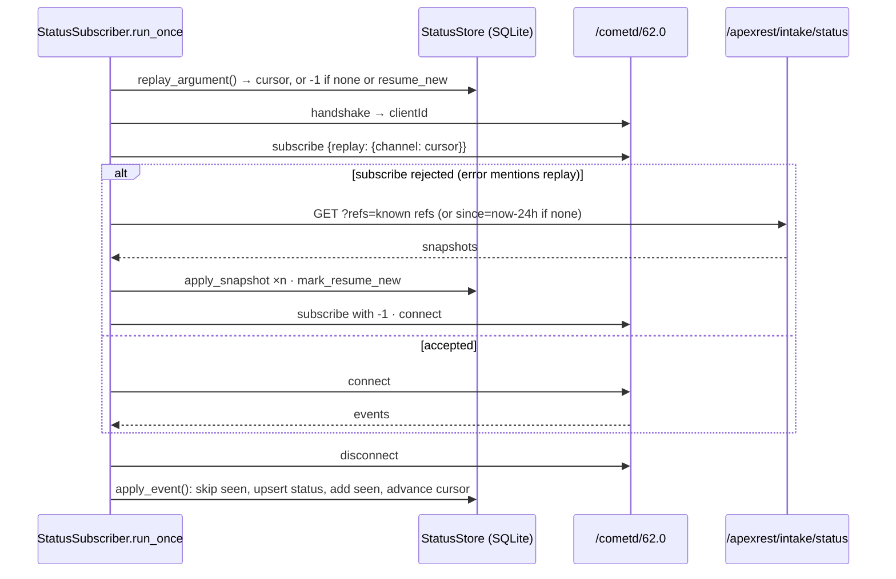

# Platform Events

> **Evidence boundary.** `Intake_Status__e`, its two publisher flows, the Apex catch-up, and the Python subscriber are **implemented**. The subscriber is **tested locally** with scripted CometD sources and a queued HTTP transport. Nothing has been published or received in a real org. Retention and API facts are from Salesforce documentation.

---

## 1. Why a platform event

| Need | How the event meets it |
| --- | --- |
| The intake agent must learn status and owner changes made by people in Salesforce | The publisher flows run on status or owner change |
| Never report a change that was rolled back | **Publish After Commit** |
| Survive subscriber downtime | Replay id plus event-bus retention |
| Recover beyond retention | Apex REST catch-up |
| Don't expose the record | 4 fields only. No PII beyond the owner's name |

Alternatives considered:

| Option | Why not chosen |
| --- | --- |
| Change Data Capture on Lead and Case | Emits every field change for every record, including non-intake ones. More data than the agent should receive. Event allocation is shared with other CDC consumers |
| Polling the REST API | Wastes API calls. Latency equals the poll interval. Misses intermediate states |
| Outbound Messages | SOAP push with a fixed payload format. Needs an endpoint Salesforce can reach |
| Apex callout to the agent | Needs the agent reachable from Salesforce, a Named Credential, and retry logic in Apex |

## 2. Event definition

| Property | Value |
| --- | --- |
| API name | `Intake_Status__e` |
| Event type | `HighVolume` |
| Publish behaviour | `PublishAfterCommit` |
| Retention | 72 hours on the event bus (Salesforce documents platform events as retained for 72 hours) |
| Channel | `/event/Intake_Status__e` |

| Field | Type | Content |
| --- | --- | --- |
| `Intake_Ref__c` | Text(40) | The intake reference |
| `Object_Type__c` | Text(40) | `Lead` or `Case` |
| `Status__c` | Text(255) | Current `Status` |
| `Owner_Name__c` | Text(255) | User name, else queue name, else blank |

## 3. Publishing



| Design choice | Reason |
| --- | --- |
| Flow (order 20), not an Apex trigger | One automation tool. Runs after the assignment flow (order 10) |
| Includes the owner change in the entry | The event after queue assignment names the queue, not the integration user |
| Owner name, not Id | The agent can show "Support Tier 1" to the customer without a second lookup |
| Runs in system context | The integration user can read but **not publish** the event |

### 3.1 Events per new record

On insert, the publisher runs for `ISNEW()`. The assignment flow then updates `OwnerId`, and that update meets the publisher's `ISCHANGED(OwnerId)` condition. A new intake record is therefore expected to publish **more than once** (insert, then owner change), all after commit and in order. The subscriber keeps the latest. Confirm the actual count on the first org run, because it affects event allocation planning.

### 3.2 Publish After Commit vs Publish Immediately

| | Publish After Commit (chosen) | Publish Immediately |
| --- | --- | --- |
| Rolled-back save | No event | Event already sent: a phantom status |
| Use case | State changes others act on | Logging or telemetry that must survive a rollback |

## 4. Subscribing

The subscriber uses the **CometD (Streaming API)** long-polling protocol over plain HTTPS, with the same OAuth token as the writer.



| Replay argument | Meaning |
| --- | --- |
| Stored id `n` | Events after `n` |
| `-1` | New events only |
| `-2` | All retained events (defined as `REPLAY_ALL`, not used) |

### 4.1 Batch semantics

`run_once` is one handshake, subscribe, connect, and disconnect. It returns `SyncStats(applied, duplicates, caught_up, replay_expired, deferred, error)`. It isn't a daemon. A scheduler or a long-lived client is a deployment choice. Run it more often than the 72-hour retention, or every outage turns into a catch-up.

## 5. Durability and ordering

| Property | Behaviour |
| --- | --- |
| Ordering | Events on one channel are delivered in replay-id order. The latest applied wins per (ref, object) |
| At-least-once | Redeliveries are possible. `seen_replay` makes apply idempotent |
| Atomic apply | Status row, seen id, and cursor commit together |
| Restart | The cursor and seen set are in SQLite and survive restarts |
| Subscriber down | `deferred=True`, cursor unchanged, error stored. Drill 6 proves resume from cursor 3 and apply at replay id 4 |

## 6. Catch-up: the Apex REST resource

```apex
@RestResource(urlMapping='/intake/status')
global without sharing class IntakeStatusResource {
    @HttpGet global static void recover() { … }
}
```

| Aspect | Design |
| --- | --- |
| Endpoint | `GET /services/apexrest/intake/status` |
| Inputs | `refs` (≤ 200, comma-separated), `since` (ISO-8601 UTC on `LastModifiedDate`), or both (AND) |
| Output | JSON array of `{intakeRef, objectType, status, ownerName}` for Leads then Cases |
| Errors | 400 for neither filter, more than 200 refs, or a bad `since` |
| Sharing | `without sharing`, because the integration user doesn't own queue-assigned records |
| Exposure | 4 fields of records that already have an intake reference |
| Test | `IntakeStatusResourceTest`, 2 methods: refs returns a Lead and a Case. A future `since` returns 0. No filter returns 400. **Not executed** |

## 7. Gaps found in review

| ID | Gap | Effect | Fix |
| --- | --- | --- | --- |
| P1 | After an expiry, catch-up queries **only references already in the status store**. `since` is used only when the store is empty | Intakes created while the subscriber was down beyond retention are never learned | Call the resource twice: once by known refs, once by `since` = last applied event time minus a margin. Or read refs from the outbox |
| P2 | Window between the catch-up snapshot and the `-1` subscription | A change in that window is missed until its next change | Record the catch-up start time and re-run a `since` catch-up after subscribing |
| P3 | `since` path returns at most 200 rows per object, with no `ORDER BY` and no continuation | Silent truncation after a large outage | `ORDER BY LastModifiedDate, Id` and return a cursor (`nextSince`, `lastId`) |
| P4 | The Apex test covers 3 of the branches (refs, future since, no filter) | Combined filters, more than 200 refs, and a bad date aren't covered | Add tests. Measure coverage once deployed |
| P5 | CometD client, one handshake per batch | Works, but the Pub/Sub API (gRPC) is Salesforce's current external subscriber API, with flow control | Migrate the event source behind the same `take(channel, replay_from)` interface |
| P6 | `seen_replay` grows without limit | Small, but unbounded | Prune ids older than retention |
| P7 | Event count per create is unmeasured (§3.1) | Allocation planning | Measure on the first org run |

## 8. Allocations and limits to check per org

| Limit | Why it matters here |
| --- | --- |
| Hourly high-volume event publishing | About 1–2 events per intake create, plus 1 per status or owner change |
| Daily event delivery to CometD or Pub/Sub clients | Each subscriber connection counts deliveries |
| Concurrent streaming clients | One subscriber per environment |
| API requests (24-hour) | REST upserts and the Apex REST catch-up consume API requests. Check how the org counts the token and streaming calls |

The exact values depend on edition and add-ons. Read them in Setup → Company Information and the Platform Events allocations page before sizing (OQ-13 volumes are still open).
