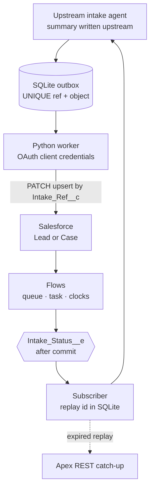

# Portfolio Summary

**Intake-to-Salesforce · Nilesh P Raghavan**

> **Evidence boundary.** Portfolio project. Built in source and **tested locally** (22 Python tests, 6 fault drills). The Salesforce metadata is **not deployed**, and the Apex test hasn't run. Decisions D1–D5 are proposed, not client-approved. No production org, real customer data, LLM call, or MuleSoft component is involved.

---

## The problem

Sales and support requests arrive through the same front door. Someone reads the inbox, decides which is which, searches Salesforce from memory, and rekeys a partial record. Customers get no reference, known people become duplicate Leads, and support requests get lost.

## What I built

An AI intake agent (upstream, represented here by 20 sample conversations) hands each conversation to this integration, which turns it into **exactly one Lead or one Case** and returns status to the agent.

| Layer | What's in it |
| --- | --- |
| **Sales Cloud and Service Cloud** | `Intake_Ref__c` external id on Lead and Case. 10 validation rules. Two queues |
| **Flows** | Two assignment flows (queue, review task, 4- and 24-hour checks). Two publisher flows |
| **Platform event** | `Intake_Status__e`, high-volume, Publish After Commit, 4 fields |
| **Apex REST** | `GET /services/apexrest/intake/status` for recovery beyond event retention |
| **Security** | External Client App with client credentials, least-privilege permission set |
| **Python (standard library)** | Durable outbox, 7-signal retry matrix, CometD subscriber, monitor |

## Design choices worth discussing

| Choice | Why |
| --- | --- |
| Deterministic routing | One phrase picks Lead or Case. Ambiguity is rejected to a person. A model writes the summary upstream and never chooses the route, owner, or status |
| Salesforce owns owner and status | The payload never sends `OwnerId` or `Status`, so replays can't undo a rep's work |
| Idempotency in three layers | Outbox key, external-id upsert, replay-id seen set. Twenty conversations replayed produce 10 Leads and 10 Cases, with nothing sent twice |
| Publish After Commit | A rolled-back save never reports a status |
| Policy before payload | M1 produced 34 business rules, 16 open questions, and a decision log before any metadata |

## Evidence

| Measure | Result |
| --- | --- |
| Python tests | **22 of 22 pass** (re-run 24 November 2026) |
| Fault drills | **6 of 6 pass**: wrong secret, network failure, validation failure, duplicate submission, API limit (429), subscriber down |
| Metadata | 32 XML files parse. **Not deployed** |
| Field mapping | 27 rows compared with the build. 4 match, 9 partial, 6 differ, 8 not stored by design |
| Requirements | 34 business rules traced: 2 built and tested, 7 built, 11 partial, 3 upstream, 11 not built |

## What the review found

I reviewed my own build against Salesforce documentation and recorded 27 findings. The five high ones are all about how a real org behaves, which a local stand-in can't show:

1. Salesforce reports the daily API limit as **403 `REQUEST_LIMIT_EXCEEDED`**, not 429, and the retry matrix would dead-letter it.
2. Replay upserts need **sharing** that lets the integration user see queue-owned records.
3. The run-as user needs **API Enabled**.
4. The REST API runs active **assignment rules** by default unless `Sforce-Auto-Assign: FALSE` is sent.
5. Scheduled paths may be **cancelled** by ordinary edits because of their shared entry formula.

Each one has a fix and an org test in [PROJECT_COMPLETION_REPORT.md](PROJECT_COMPLETION_REPORT.md).

## Skills shown

`Salesforce solution design` · `Requirements and decision logs` · `Record-triggered Flows` · `Platform Events` · `Apex REST` · `OAuth 2.0 client credentials` · `External Client Apps` · `Integration patterns` · `Idempotency and retry design` · `Fault injection` · `Python` · `Technical writing`

## Read next

[README](README.md) · [ARCHITECTURE](ARCHITECTURE.md) · [FAULT_DRILLS](FAULT_DRILLS.md) · [INTERVIEW_GUIDE](INTERVIEW_GUIDE.md)

**Author:** Nilesh P Raghavan · [GitHub](https://github.com/NileshModlier)
