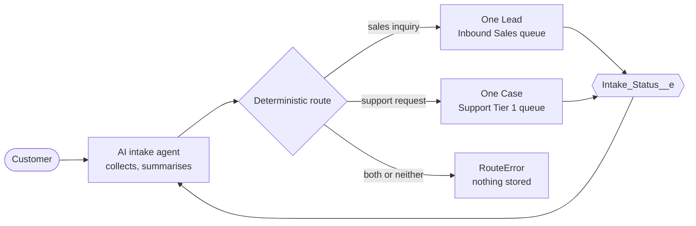

# Project Overview

**Intake-to-Salesforce CRM Integration** · Portfolio engagement package · M1–M6

> **Evidence boundary.** Salesforce metadata is source and has not been deployed. The Python suite (22 tests) passed against local stand-ins. The Apex test hasn't run. The policy decisions D1–D5 are proposed. No client, org, or real customer data is involved.

---

## 1. Engagement in one paragraph

A business receives sales and support inquiries through web forms, email, chat, and phone. Today a person reads a shared inbox, decides which is which, searches Salesforce from memory, and rekeys a partial record. This package designs the replacement: an AI intake agent collects the conversation, and a deterministic integration commits **one Lead** for a net-new sales inquiry or **one Case** for a support request. Each record carries a stable intake reference. Salesforce flows assign queues and tasks, and a platform event tells the agent what happened next. The package runs from discovery (M1) to handover (M6) and is written the way a consulting team would hand it to a client.

## 2. Business problem

| Symptom (as-is baseline, to be confirmed in a workshop) | Cost |
| --- | --- |
| Customers get no reference and can't tell whether a follow-up is new | Repeat contacts and restated requests |
| Known people become second Leads | Double outreach and a polluted pipeline |
| Support items stay in a mailbox or arrive as thin Cases | Slow first response and items that can't be found |
| "This person wrote to us" is treated as consent to sell | Privacy and compliance exposure |

The as-is map is labelled a **baseline hypothesis**. No workshop transcript, volume, or timestamp is claimed.

## 3. Target outcome

| Outcome | Mechanism | State |
| --- | --- | --- |
| One reference for every intake | `Intake_Ref__c`, `INT-YYYYMMDD-####`, unique and immutable | Implemented |
| No duplicate records on replay | External-id upsert and outbox unique key | Implemented, tested locally |
| Salesforce owns assignment | Flows assign the queue. The integration never sends `OwnerId` or `Status` | Implemented |
| Follow-up is visible | Review task, 24-hour Lead escalation, 4- and 24-hour Case monitoring tasks | Implemented, org tests not executed |
| The agent knows the outcome | Platform event after commit, plus Apex catch-up | Implemented, tested locally |
| Failures are recoverable and visible | Retry matrix, Dead Letter, monitor | Implemented, tested locally |
| Consent, confidence, duplicate matching, Mixed intakes | Lead rules L1–L9 and Case rules C1–C2 | Designed, not built |

## 4. Stakeholders

| Role | What they get | Accountable for |
| --- | --- | --- |
| Customer | A receipt with an intake reference | The request and the consent choice |
| Sales Representative | A Lead in the Inbound Sales queue with a review task | Working the Lead |
| Support Agent | A Case in Support Tier 1 with a priority task | Working the Case |
| Sales Manager | Visibility of holds and qualification | Lead policy, holds, the sales queue |
| Support Lead | Priority paths and failed or unlinked Cases | Case policy, the support queue |
| Salesforce Admin | A deployable SFDX package and a runbook | Deploy, permission set, queue membership |
| Integration Owner | A worker, a subscriber, and a monitor | Credentials, Dead Letter review |

## 5. Scope by phase

| Phase | Delivered | State |
| --- | --- | --- |
| **M1 Discovery** | 12 user stories, 8 functional requirements, 34 business rules, 7 non-functional requirements, as-is and to-be maps, 27-row field-mapping workbook, decisions D1–D5, 13 assumptions, 16 open questions, 8 risks | Designed. Approval pending |
| **M2 Org configuration** | 7 fields, 10 validation rules, 2 queues, 1 permission set, 2 assignment flows, decision D6 | Implemented. Not deployed |
| **M3 Integration** | OAuth client credentials, REST upsert, SQLite outbox and worker, 20 sample conversations | Implemented. Tested locally |
| **M4 Status sync** | `Intake_Status__e`, 2 publisher flows, Apex REST catch-up, subscriber | Implemented. Tested locally (Python). Apex not executed |
| **M5 Reliability** | 7-signal retry matrix, monitor, 6 fault drills | Implemented. Tested locally |
| **M6 Handover** | Admin guide, demo script, interview guide, portfolio copy | Documented |

### Explicitly out of scope

Contact or Account creation, Lead conversion, Opportunity creation, territory assignment, a second support queue, topic routing, data cleanse of existing duplicates, historical backfill, prompt design and model selection, and any production deployment.

## 6. Key numbers

| Measure | Count | Source |
| --- | ---: | --- |
| Sample conversations | 20 | `tests/sample_conversations.py`, `INT-20261124-0001` to `-0020` |
| Routed to Lead / Case | 10 / 10 | Re-run of `classify()` on all 20 |
| Case priorities in the samples | High 4 · Medium 4 · Low 2 | Re-run of `build_payload()` |
| Channels in the samples | Email 6 · Web 6 · Phone 4 · Chat 4 | Sample data |
| Field-mapping rows | 27 | Workbook L-01–L-09, C-01–C-09, CS-01–CS-09 |
| Platform events | 1, with 4 fields | `Intake_Status__e` |
| Retry signals | 7 | `RETRY_MATRIX` |
| Python tests | 22 passing | Re-run 24 November 2026 |
| Fault drills | 6 passing | `python -m tests.test_fault_drills` |
| Apex test methods | 2, not executed | `IntakeStatusResourceTest` |
| Org flow tests | 17 written (T1–T17) plus 6 added in review (T18–T23), not executed | `docs/flow-design.md`, [FLOW_DESIGN.md](FLOW_DESIGN.md) |

## 7. Architectural principles

1. **Salesforce is the system of record after commit.** Nothing outside Salesforce sets owner or status.
2. **Idempotency at every hop.** Outbox key, external-id upsert, replay-id deduplication.
3. **Publish after commit.** A rolled-back save never reaches the agent.
4. **Classify failures, don't guess.** Retry only what can succeed later, and dead-letter the rest with a reason.
5. **Least privilege.** One integration user, one permission set, no delete, no View All.
6. **AI writes words, not decisions.** A model may produce the summary. Code and flows decide the route and the outcome.
7. **Say what isn't built.** Every document separates implemented, tested, designed, and not executed.

## 8. Status

M6 handover is complete as a portfolio package. Go-live would need the open questions that block build (OQ-02, OQ-05, OQ-07, OQ-08), client approval of D1–D5, a sandbox deployment, an execution of the Apex and flow tests, and the fixes in [PROJECT_COMPLETION_REPORT.md](PROJECT_COMPLETION_REPORT.md) §5.
