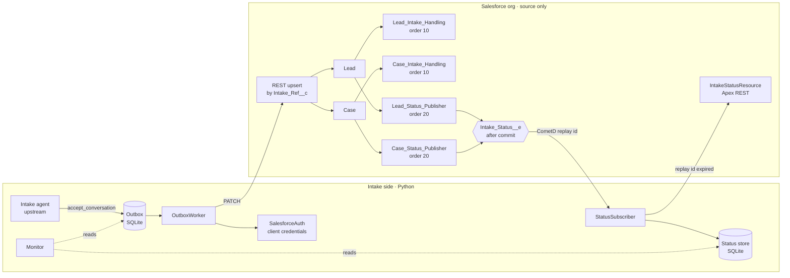

# Intake-to-Salesforce

**One intake conversation becomes one Salesforce Lead or one Case, and status comes back to the intake agent.**

> **Evidence boundary.** The Salesforce metadata in this repository is source. It has **not been deployed to an org**. The 22 Python tests ran against a local HTTP stand-in, and the Apex test class has **not run**. Decisions D1–D5 are **proposed** and haven't been approved by a client. No production org, real customer data, or live Salesforce traffic is involved. Every statement in this documentation set is labelled with one of the tags below.

| Tag | Meaning |
| --- | --- |
| **Implemented** | In source: Salesforce metadata or Python code |
| **Tested locally** | Exercised by the Python suite against an in-memory or HTTP stand-in |
| **Designed** | Written policy (requirements, decision log, workbook) that isn't built |
| **Not executed** | Written to run in an org, but hasn't run (Apex test, flow test script) |
| **Not built** | Named as future work |

`Sales Cloud` · `Service Cloud` · `Record-triggered Flows` · `Platform Events` · `Apex REST` · `External Client Apps` · `OAuth 2.0 Client Credentials` · `Python 3.11+ (standard library)` · `Outbox pattern` · `SQLite` · `Salesforce DX, API 62.0`

| 20 sample conversations | 10 → Lead · 10 → Case | 27 field-mapping rows | 1 platform event, 4 fields |
|:---:|:---:|:---:|:---:|
| **7 retry signals** | **22 Python tests passing** | **6 fault drills** | **0 orgs deployed** |

---

## Contents

- [Overview](#overview)
- [Architecture](#architecture)
- [What is in Salesforce](#what-is-in-salesforce)
- [What is in Python](#what-is-in-python)
- [Where AI sits](#where-ai-sits)
- [Run the tests](#run-the-tests)
- [Deploy](#deploy)
- [Known gaps before go-live](#known-gaps-before-go-live)
- [Documentation map](#documentation-map)

---

## Overview

A shared inbox is the usual front door for both sales and support. A person reads it when they can, decides which is which, searches Salesforce from memory, and rekeys a partial Lead or Case. Customers have no reference to quote. Known people become second Leads, and support items get lost in the mailbox.

Intake-to-Salesforce replaces that hand-off with a contract.

| Rule | How it is enforced |
| --- | --- |
| A sales inquiry becomes **one Lead**. A support request becomes **one Case** | Deterministic router in `integration/outbox.py`. Anything matching both or neither raises `RouteError`, and nothing is stored |
| Every intake carries a reference `INT-YYYYMMDD-####` | Unique, case-insensitive external id `Intake_Ref__c` on Lead and on Case, plus format and immutability validation rules |
| A replay updates the same record, never a second one | `PATCH /sobjects/{Lead\|Case}/Intake_Ref__c/{ref}` upsert, and a `UNIQUE (intake_ref, object)` outbox key |
| Salesforce owns assignment and status | The upsert body never sends `Status` or `OwnerId`. Record-triggered flows assign the queue |
| Status returns after commit only | `Intake_Status__e` is high-volume and **Publish After Commit**. A rolled-back save produces no event |
| Missed events are recoverable | The subscriber stores its replay id. If the id has expired, it calls the Apex REST catch-up `GET /services/apexrest/intake/status` |
| Failures are classified, not guessed | A seven-signal retry matrix: retry, back off, refresh once, or Dead Letter |

## Architecture



Salesforce is the **system of record** after a successful commit. The intake agent is the **system of engagement** until that commit. The Python package is the commit boundary and the status return path. Full detail: [ARCHITECTURE.md](ARCHITECTURE.md).

## What is in Salesforce

**Implemented** as Salesforce DX source, API 62.0. **Not deployed.**

| Metadata | Count | Names |
| --- | ---: | --- |
| Custom fields | 7 | Lead: `Intake_Ref__c`, `Intake_Summary__c`, `Intake_Channel__c`, `Qualification_Reason__c`. Case: `Intake_Ref__c`, `Intake_Summary__c`, `Intake_Channel__c` |
| Validation rules | 10 | 5 on Lead, 5 on Case |
| Queues | 2 | `Inbound_Sales` (Lead, Task), `Support_Tier_1` (Case, Task) |
| Record-triggered flows | 4 | `Lead_Intake_Handling`, `Case_Intake_Handling` (order 10), `Lead_Status_Publisher`, `Case_Status_Publisher` (order 20) |
| Platform event | 1 | `Intake_Status__e`: `Intake_Ref__c`, `Object_Type__c`, `Status__c`, `Owner_Name__c` |
| Apex classes | 2 | `IntakeStatusResource` (`@RestResource`, `without sharing`), `IntakeStatusResourceTest` (2 test methods, **not executed**) |
| Permission set | 1 | `Intake_Integration`: create, read, and edit on Lead and Case, read on the event, access to the Apex class. No delete, View All, or Modify All |

The **External Client App** that issues client-credentials tokens is created in the org. It isn't in the metadata. See [INTEGRATION_GUIDE.md](INTEGRATION_GUIDE.md) §3.

## What is in Python

**Implemented.** Six modules, 1,358 lines, standard library only.

| Module | Responsibility |
| --- | --- |
| `sf_auth.py` | OAuth 2.0 client credentials grant. Token cached in memory, never written to disk or logs |
| `sf_client.py` | `PATCH` upsert by external id. One token refresh on a 401 |
| `outbox.py` | Router, payload builder, SQLite outbox (Pending → Retrying → Synced or Dead Letter), worker |
| `retry_matrix.py` | Seven signals mapped to an action. Backoff 1, 2, 4, 8 s, capped at 60. Dead Letter on attempt 5 |
| `subscriber.py` | CometD batch read from the stored replay id, duplicate suppression, Apex catch-up on an expired id |
| `monitor.py` | One-shot read of outbox counts, retry attempts, dead letters, replay cursor, and last subscriber error |

## Where AI sits

The intake agent that talks to the customer is **upstream of this repository**. Here it's represented by 20 sample conversations in `tests/sample_conversations.py`.

| Concern | Who decides | In this repository |
| --- | --- | --- |
| Lead or Case | Deterministic code | `classify()` matches the phrases "sales inquiry" and "support request". Both or neither is a `RouteError` |
| Delivery state | Deterministic code | Four-state outbox, driven by the retry matrix |
| Owner, queue, task, escalation | Salesforce flows | No model and no Python code sets `OwnerId` or `Status` |
| Status returned to the agent | Salesforce, after commit | `Intake_Status__e` |
| Conversation summary | Upstream intake agent | Arrives as an input field and is stored in `Intake_Summary__c`. **No model is called in this repository** |

The design principle is that a language model may *write the summary*, but it never chooses the route, the owner, or the status. The policy for the full agent (consent, confidence bands, exact-email matching, Mixed intakes) is **designed** in [SOLUTION_DESIGN.md](SOLUTION_DESIGN.md) and isn't built here. [REQUIREMENTS_TRACEABILITY.md](REQUIREMENTS_TRACEABILITY.md) shows rule by rule what is built and what isn't.

## Run the tests

```bash
python -m unittest discover -s tests          # 22 tests, no third-party packages
python -m tests.test_fault_drills             # prints the six fault-drill results
```

**Tested locally:** re-run for this documentation on 24 November 2026, with **22 passed** (Python 3.13). The suite uses an in-memory Salesforce, a `ThreadingHTTPServer` stand-in, scripted CometD sources, and a closed port for network failure.

Run against an org, once one is authorized and the environment variables in [INTEGRATION_GUIDE.md](INTEGRATION_GUIDE.md) are set:

```bash
python -m integration.outbox      # deliver ready rows once
python -m integration.monitor     # print counts and dead letters once
```

## Deploy

```bash
sf project deploy start --manifest manifest/package.xml
```

Then create the External Client App and the integration user, assign `Intake_Integration`, run `IntakeStatusResourceTest`, and run org tests T1–T23 in [FLOW_DESIGN.md](FLOW_DESIGN.md). **None of these steps has been performed.**

## Known gaps before go-live

Found in this documentation review. Detail and fixes are in [PROJECT_COMPLETION_REPORT.md](PROJECT_COMPLETION_REPORT.md).

| Gap | Why it matters |
| --- | --- |
| Salesforce signals the daily API limit as **HTTP 403 `REQUEST_LIMIT_EXCEEDED`**, not 429 | The matrix dead-letters every 403 at once, so a limit event would dead-letter the whole queue |
| Upsert replay depends on the integration user **seeing** a queue-owned record | Under a Private sharing model the upsert can't match, tries an insert, and hits the unique index |
| The run-as user needs **API Enabled**, which the permission set deliberately doesn't grant | Token issuance and REST calls fail without it |
| The scheduled paths share an entry formula that is false on every later save | Salesforce cancels pending scheduled paths when a record stops meeting entry conditions, so ordinary edits may cancel the escalation clocks |
| The client doesn't send `Sforce-Auto-Assign: FALSE` | The REST API runs an active assignment rule by default, which could reassign a worked record on an update |
| Dead Letter rows can't be re-queued after a correction | `accept_conversation` returns Dead Letter unchanged |
| Catch-up after a long outage asks only for references the subscriber already knows | Records created during the outage aren't recovered |
| Consent, confidence bands, Mixed intakes, P1–P4, and Contact matching are **designed, not built** | The M1 policy is ahead of the M3 build |

## Documentation map

| Reader | Start with |
| --- | --- |
| Recruiter, hiring manager | [PORTFOLIO_SUMMARY](PORTFOLIO_SUMMARY.md) · [PROJECT_OVERVIEW](PROJECT_OVERVIEW.md) · [RESUME_BULLETS](RESUME_BULLETS.md) |
| Architect | [ARCHITECTURE](ARCHITECTURE.md) · [SOLUTION_DESIGN](SOLUTION_DESIGN.md) · [PLATFORM_EVENTS](PLATFORM_EVENTS.md) |
| Integration engineer | [INTEGRATION_GUIDE](INTEGRATION_GUIDE.md) · [IDEMPOTENCY](IDEMPOTENCY.md) · [ERROR_HANDLING](ERROR_HANDLING.md) · [FAULT_DRILLS](FAULT_DRILLS.md) |
| Salesforce admin | [FLOW_DESIGN](FLOW_DESIGN.md) · [FIELD_MAPPING_GUIDE](FIELD_MAPPING_GUIDE.md) |
| Business analyst, consultant | [CONSULTANT_PLAYBOOK](CONSULTANT_PLAYBOOK.md) · [REQUIREMENTS_TRACEABILITY](REQUIREMENTS_TRACEABILITY.md) |
| Interview preparation | [INTERVIEW_GUIDE](INTERVIEW_GUIDE.md) (150 questions) |
| Status | [PROJECT_COMPLETION_REPORT](PROJECT_COMPLETION_REPORT.md) |
| Original working papers | [docs/solution-design.md](docs/solution-design.md) · [docs/requirements.md](docs/requirements.md) · [docs/field-mapping.xlsx](docs/field-mapping.xlsx) · [docs/process-maps/](docs/process-maps/) · [docs/admin-guide.md](docs/admin-guide.md) |

---

**Author:** Nilesh P Raghavan · [GitHub](https://github.com/NileshModlier) · Portfolio project. Names and companies in the samples (Jordan Lee, Northline Analytics, Samir Patel, Harbor Co) are illustrative, and addresses use `example.com`.
