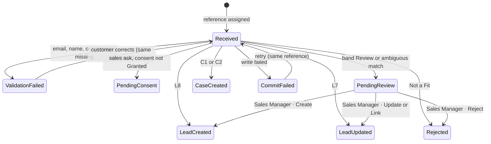
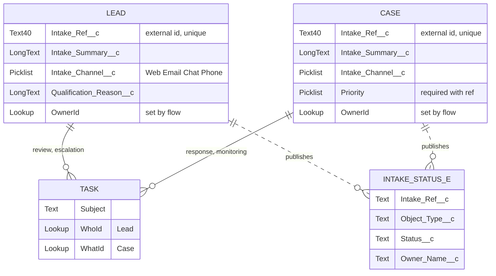

# Solution Design

> **Evidence boundary.** §2–§6 restate the **designed** policy from `docs/solution-design.md` and `docs/requirements.md`. It is **proposed** and not approved by a client. §7–§9 describe what is **implemented** in source. §10 sets the two side by side. Nothing has been deployed.

---

## 1. Design summary

| Layer | Decision |
| --- | --- |
| Intake policy | Assign a reference, normalize, validate, record consent, classify, match, then commit. Always in that order (BR-25) |
| Object model | Lead for a net-new commercial ask. Case for service. A known Contact with a commercial ask is held for the Sales Manager (D1) |
| Identity | Exact match on normalized email. No fuzzy match, no merge, no Contact or Account write (D2) |
| Consent | Sales contact needs an explicit Granted. Service never depends on it (D3) |
| Routing | Priority only: P1 and P2 urgent, P3 and P4 standard (D5). Implemented as one Case queue with priority-specific tasks (D6) |
| Integration | External-id upsert from a durable outbox. Status back on a platform event after commit. Apex REST catch-up |
| Automation | Record-triggered after-save flows for assignment, tasks, scheduled follow-up, and event publishing |
| AI | The agent writes the summary. Deterministic rules and flows make every decision |

## 2. Personas and accountability

| Persona | Accountable for | Never does |
| --- | --- | --- |
| Customer | The request and the consent choice | n/a |
| AI Intake Agent | Reference, normalization, classification, match counts, route | Create a Contact or Account, convert a Lead, set a closed status |
| Sales Representative | Working the Lead | Pull a held item before disposition |
| Support Agent | Working the Case and its status | Guess a Contact for an unlinked Case |
| Sales Manager | Lead rules, holds, Link / Update / Create / Reject dispositions | Let a timeout create a Lead |
| Support Lead | Case priority, the support queue, failed and unlinked support intakes | Drop a Case because no topic matches |

## 3. Requirements baseline

| Artifact | Count | Notes |
| --- | ---: | --- |
| User stories | 12 | US-01 to US-12, each with acceptance criteria and failure conditions |
| Functional requirements | 8 | FR-1 to FR-8 |
| Business rules | 34 | BR-01 to BR-34 |
| Non-functional requirements | 7 | NFR-1 to NFR-7 |
| Assumptions | 13 | A-01 to A-13 |
| Open questions | 16 | OQ-01 to OQ-16. OQ-02, OQ-05, OQ-07, and OQ-08 block build of their slices |
| Risks | 8 | R1 to R8 |

Rule-by-rule status: [REQUIREMENTS_TRACEABILITY.md](REQUIREMENTS_TRACEABILITY.md).

## 4. Decision log

All of D1–D5 are **Proposed**. D6 is **Configured in source**.

### D1 · Lead versus Contact

A Lead is only for a person the org doesn't know, and only for a commercial ask that passed consent, confidence, and the Not a Fit gate. Service is always a Case. A known Contact with a commercial ask and no service ask is held for the Sales Manager. Intake doesn't convert Leads or create Contacts, Accounts, or Opportunities.

| Option | Rejected because |
| --- | --- |
| Always create a Lead, then convert | Support traffic and existing customers inflate the funnel and duplicate Contacts |
| Contacts only | Unqualified strangers don't belong on Contact. Company is needed for a new logo |
| **Lead for net-new sales, Case for service, hold for a known Contact** | Chosen |

### D2 · Duplicate handling

Normalize email (trim and lowercase) and match it exactly. Never match on name or company. Never merge, overwrite a Contact, or reopen a closed Lead. A timeout can't choose a disposition.

### D3 · Consent

Granted, Declined, and Unanswered are distinct values. Only Granted allows a Lead write. Neither Declined nor Unanswered stops a Case. Choice, timestamp, channel, and statement version are governed attributes.

### D4 · Retention

CRM records follow the client's retention. Raw channel text is assumed to be kept 24 months. Passwords, card numbers, and government identifiers are never requested and are removed before commit. Erasure keeps the intake id as proof.

### D5 · Case routing

Priority only, until a topic list is approved. Band Review never stops a Case. Inferred priority on a Review-band Case is capped at P3 unless the customer stated a higher urgency.

### D6 · M2 implementation names

| M1 proposal | M2 metadata |
| --- | --- |
| `Intake_Id__c` | `Intake_Ref__c` on Lead and Case. Text(40), external id, unique, case-insensitive |
| Summary in Description | `Intake_Summary__c`, long text 5,000. Description stays free for people |
| Channel attribute | `Intake_Channel__c`, restricted picklist |
| Qualification picklist | `Qualification_Reason__c` long text on Lead. The picklist isn't created |
| Urgent and standard queues | One Case queue, Support Tier 1. Priority changes the task and the clock |
| Unassigned sales queue | Lead queue Inbound Sales |

## 5. Decision tables

### 5.1 Lead decision (Sales or Mixed only, first match wins)

| # | When | Lead result |
| --- | --- | --- |
| L1 | Not a Fit | No Lead. Rejection visible |
| L2 | Band Review | No Lead. Classification hold |
| L3 | Consent not Granted | No Lead. Pending Consent |
| L4 | One or more Contacts | No Lead, no update. Sales hold |
| L5 | More than one open Lead | No Lead. Sales hold |
| L6 | No open Lead, at least one closed Lead | No Lead. Closed stays closed. Sales hold |
| L7 | Exactly one open Lead, no Contact | Update that Lead. Keep status and the original id. Append the new id once |
| L8 | No Contact, no Lead | Create one Lead at Open - Not Contacted in the unassigned queue |
| L9 | L7 or L8, but last name or company needs a placeholder | Don't write. Keep the reason |

### 5.2 Case decision (Support or Mixed only)

| # | When | Case result |
| --- | --- | --- |
| C1 | Exactly one Contact | One Case, `ContactId` set, identity "Contact linked" |
| C2 | Zero or several Contacts | One Case, `ContactId` blank, identity "No Contact match" or "Several Contacts" |

### 5.3 Priority crosswalk

| Intake | Lead Rating | Case Priority | Path |
| --- | --- | --- | --- |
| P1 | Hot | High | Urgent |
| P2 | Hot | High | Urgent |
| P3 | Warm | Medium | Standard |
| P4 | Cold | Low | Standard |

## 6. Intake state model (designed)

Customer messaging follows the state. A receipt confirms receipt only (BR-02). A later message may mention a Case or a representative only after that write succeeded.

## 7. As-built data model (Implemented)

A reference may sit on one Lead and one Case (uniqueness is per object). It can't sit on two Leads or two Cases.

## 8. As-built automation (Implemented, org tests not executed)

| Flow | Entry | Actions |
| --- | --- | --- |
| `Lead_Intake_Handling` (10) | Ref set, and new or ref changed | Inbound Sales queue (Custom Error if missing), review task, scheduled path at 24 h: a High escalation task if still Open - Not Contacted |
| `Case_Intake_Handling` (10) | Same | Support Tier 1 queue, urgent or standard task by Priority, scheduled 4 h (High and still New) and 24 h (still New) tasks |
| `Lead_Status_Publisher` (20) | Ref set, and new, Status changed, or Owner changed | Owner name from User, else Group (queue), else blank. Publish `Intake_Status__e` |
| `Case_Status_Publisher` (20) | Same | Same |

Detail: [FLOW_DESIGN.md](FLOW_DESIGN.md).

## 9. As-built integration (Implemented, tested locally)

| Step | Implementation |
| --- | --- |
| Accept | `Outbox.accept_conversation`: validate reference format, `classify`, `build_payload`, canonical JSON, one row per (ref, object) |
| Authenticate | `SalesforceAuth.get_access_token`: client credentials, cached, refreshed 60 s before the assumed expiry |
| Deliver | `OutboxWorker.run_once`: `PATCH` upsert, apply the retry matrix |
| Return status | `StatusSubscriber.run_once`: one CometD batch from the cursor. Catch-up on an expired replay id |
| Observe | `python -m integration.monitor` |

Detail: [INTEGRATION_GUIDE.md](INTEGRATION_GUIDE.md).

## 10. Designed versus built

| Capability | Designed (M1) | Built (M2–M5) |
| --- | --- | --- |
| Intake reference | `Intake_Id__c`, history of later ids | `Intake_Ref__c`, unique and immutable. **No history field** |
| Classification | Sales, Support, Mixed, with confidence band Auto or Review | Phrase router: Lead or Case. **Mixed raises `RouteError`**. No band |
| Consent | Granted, Declined, Unanswered, plus governed attributes | **Not built** |
| Match | Exact normalized-email counts against Contact and Lead | **Not built.** Every sales inquiry upserts its own Lead by reference |
| Email normalization | Trim and lowercase | **Trim only** |
| Priority | P1–P4 stored, plus Rating and Case Priority crosswalk | Case Priority High, Medium, or Low from input or keywords. **No P1–P4, no Lead Rating** |
| Summary | Description with a 4-line header | `Intake_Summary__c` (D6). Description untouched |
| Case Subject | First 120 characters with an ellipsis | Built as designed |
| Contact link on Case | `ContactId` on exactly one match | **Not built.** `SuppliedEmail`, `SuppliedName`, and `SuppliedCompany` are written |
| Lead status on create | Open - Not Contacted | Not sent. The org default applies |
| Holds and failure visibility | An operations list (OQ-04, store not chosen) | Dead Letter rows plus the monitor printout |
| Queues | Urgent and standard | One Case queue. Priority drives the task (D6) |

The gap is intentional and documented. M2–M5 built the commit and return mechanics. The policy gates belong to the upstream agent and to a later build phase after the open questions close.

## 11. Open questions that block build

| ID | Question | Blocks |
| --- | --- | --- |
| OQ-02 | Jurisdictions, and whether opt-in is legally required | Any Lead write |
| OQ-05 | Known Contact with a commercial ask: hold, Lead, or Opportunity? | Known-customer sales path |
| OQ-07 | Person Accounts in use? | Lead versus Contact |
| OQ-08 | Live Lead Status and Case Status values | Status mapping and the scheduled flow paths |

Also needed before go-live, though not blocking design: OQ-04 (where holds live), OQ-13 (volumes), OQ-16 (consent wording).

## 12. Risks

| ID | Risk | Mitigation in design | Remaining |
| --- | --- | --- | --- |
| R1 | Many existing duplicate Contacts | Refuse to guess. Unlinked Cases | A separate cleanse project |
| R2 | Live status values differ | OQ-08 blocks build | Read the org picklists |
| R3 | Secrets in summaries | BR-34 | Detection method not designed |
| R4 | Wrong legal basis for consent | OQ-02 blocks Lead build | Legal review |
| R5 | Known-customer holds pile up | Visible, ordered holds | Close OQ-05 |
| R6 | Urgent queue mixes topics | Priority separates P1 and P2 | A topic list when one exists |
| R7 | As-is baseline is wrong | Labelled a hypothesis | Workshop |
| R8 | A build stores consent in Description | Governed attributes listed | Reject such a build |
| R9 *(review)* | Daily API limit returns 403, which the matrix dead-letters | n/a | Fix in the retry matrix ([ERROR_HANDLING.md](ERROR_HANDLING.md) §6) |
| R10 *(review)* | Private sharing hides queue-owned records from the integration user | n/a | Sharing rule or OWD confirmation ([IDEMPOTENCY.md](IDEMPOTENCY.md) §6) |
| R11 *(review)* | Later edits cancel the pending escalation and monitoring paths, because the shared entry formula turns false | n/a | Separate scheduled-path flows with a stable condition. Org test T22 ([FLOW_DESIGN.md](FLOW_DESIGN.md) §8) |
| R12 *(review)* | An active org assignment rule reassigns records on API updates | n/a | Send `Sforce-Auto-Assign: FALSE` ([INTEGRATION_GUIDE.md](INTEGRATION_GUIDE.md) §5.1) |
