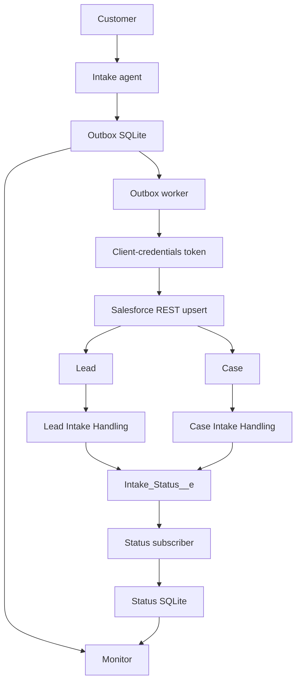
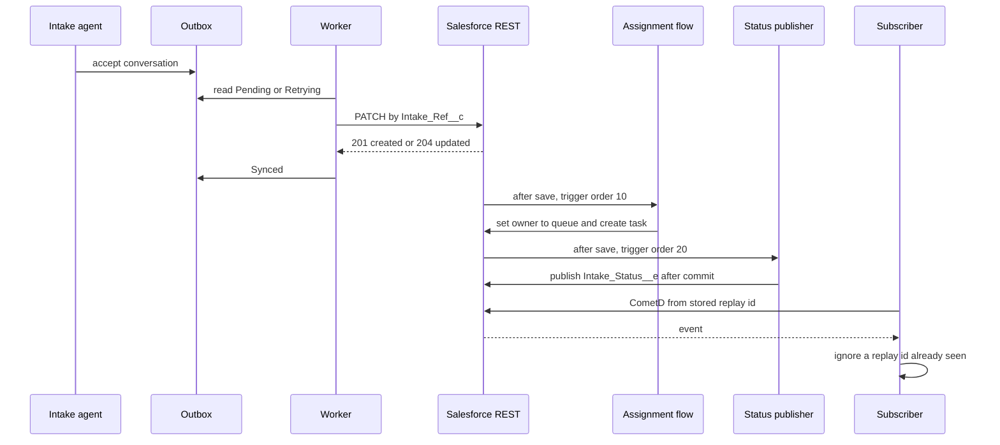
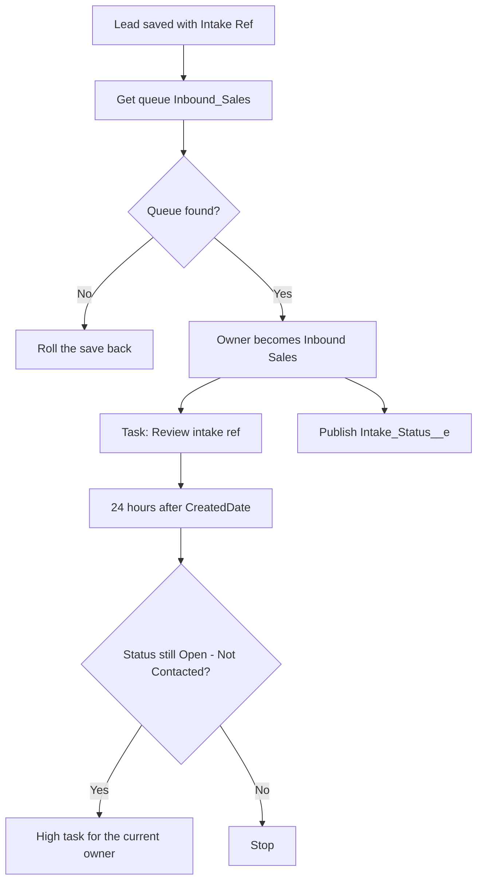
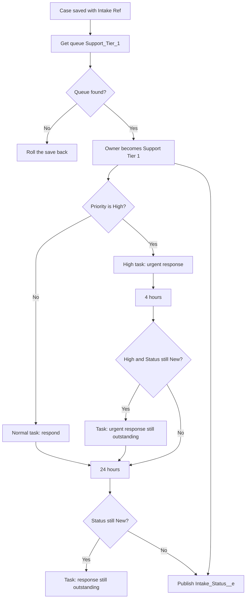
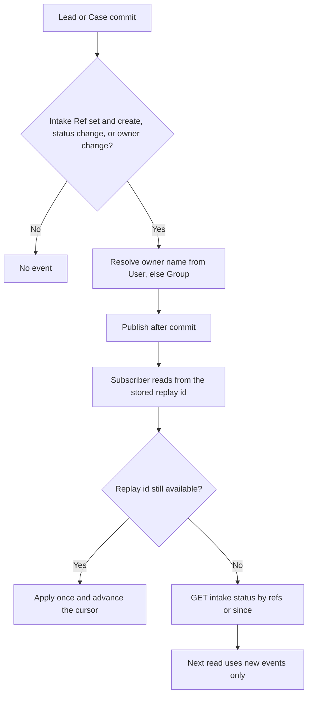

# Architecture

| | |
|---|---|
| Project | Intake-to-Salesforce CRM Integration |
| Phase | M6 — Handover |
| Document | Architecture and the five project diagrams |
| Version | 0.1 |
| Date | 24 November 2026 |
| Related | [Solution design](solution-design.md), [Flow design](flow-design.md), [Admin guide](admin-guide.md) |

Salesforce is the system of record after a successful commit. The intake agent is the system of engagement until that commit. The Python package is the commit boundary and the status return path. The as-is mailbox process in the process maps is a baseline hypothesis, not a workshop transcript.

## 1. Architecture

A conversation is classified, stored once in the outbox, and upserted by `Intake_Ref__c`. Salesforce flows assign the queue and publish `Intake_Status__e` after the save commits. The subscriber writes the latest status back to SQLite. The monitor reads both databases once.

Sales inquiry text becomes a Lead. Support request text becomes a Case. The same reference may exist on one of each. A second record of the same object is rejected by the unique external id.

The upsert body omits Status and OwnerId. Replay cannot pull a record off the queue the flows assigned.

## 2. Sequence

One successful delivery, then the status event. Token caching is omitted. A 401 on the API call refreshes the token once before this sequence continues.

## 3. Lead flow

`Lead_Intake_Handling` runs only when Intake Ref is set and the record is new or the reference changed. `Lead_Status_Publisher` also runs when status or owner changes, so the event after queue assignment carries the queue name.

The 24-hour path does not change Status, Rating, or Intake Ref. The escalation is a task. If the org does not use the status `Open - Not Contacted`, the scheduled path does not fire. That value is still open question OQ-08.

## 4. Case flow

High and standard cases share Support Tier 1. Priority changes the task and the clock.

A case that has left New gets neither monitoring task. Tasks use WhatId. They do not require a Contact.

## 5. Platform events

`Intake_Status__e` is high volume and publishes after commit. A rolled-back save produces no event. The subscriber stores the replay id. A repeated replay id is ignored. An expired cursor is recovered from `IntakeStatusResource`, then the subscriber continues with new events only.

If CometD cannot be reached, the cursor stays put and the error is stored for the monitor. The next run requests events after that same cursor.

The catch-up class is `without sharing`. After queue assignment the integration user no longer owns the record, and the permission set does not grant view all. The response is limited to intake reference, object type, status, and owner name.
