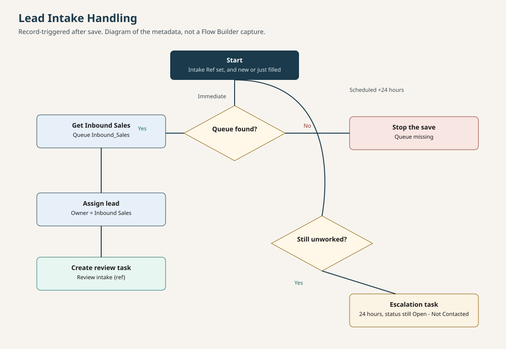
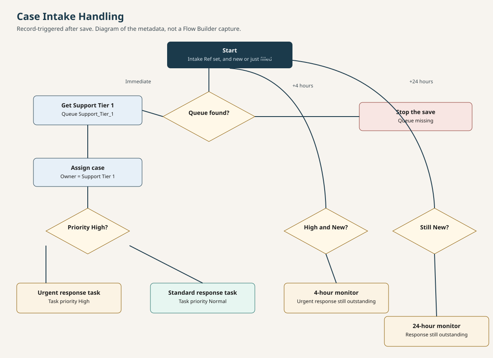

# Flow design

| | |
|---|---|
| Project | Intake-to-Salesforce CRM Integration |
| Phase | M2 — Org configuration and flows |
| Document | Flow inventory, metadata inventory, and tests |
| Version | 0.1 |
| Status | Source configured. Not deployed. Runtime tests not executed. |
| Date | 24 November 2026 |
| Related | [Solution design](solution-design.md), SFDX project at the repository root |

This document describes the M2 assignment flows. M4 later added the platform event `Intake_Status__e` and the two status publishers. Both M2 automations are record-triggered flows.

The images in [flow-screenshots](flow-screenshots/) are diagrams of the metadata. They are not captures from Flow Builder. No Salesforce org or CLI was available to deploy the flows and photograph the canvas.

## 1. Flow inventory

| Flow API name | Label | Object | Type | Status | Paths |
|---|---|---|---|---|---|
| `Lead_Intake_Handling` | Lead Intake Handling | Lead | Record-triggered, after save | Active | Immediate assignment and review task. Scheduled path 24 hours after CreatedDate. |
| `Case_Intake_Handling` | Case Intake Handling | Case | Record-triggered, after save | Active | Immediate queue routing and priority task. Scheduled path at 4 hours. Scheduled path at 24 hours. |

Entry formula for both:

```text
Intake Ref is not blank
AND (the record is new OR Intake Ref changed)
```

A save that does not change Intake Ref does not start the immediate path, so the review task is not duplicated. The scheduled paths are armed from CreatedDate when an interview starts. Filling Intake Ref on a later edit starts a new interview and arms another set of scheduled paths from the original CreatedDate. If that moment is already in the past, Salesforce runs the path shortly after the interview starts. That is acceptable: a late-tagged record should still be checked.

### Lead Intake Handling



| Step | Element | Result |
|---|---|---|
| 1 | Get Inbound Sales queue | Group where Type = Queue and DeveloperName = `Inbound_Sales`. |
| 2 | Queue found | Missing queue stops the save. The lead is not left with the creating user. |
| 3 | Assign to Inbound Sales | Lead OwnerId becomes the queue. |
| 4 | Create review task | Subject `Review intake {Intake Ref}`. Priority Normal. Status Not Started. Owner is the queue. WhoId is the lead. Due today. |
| 5 | 24-hour path | If Status is still `Open - Not Contacted`, create a High task `Escalation: intake {ref} unworked for 24 hours` for the current owner. Any other status ends the path. |

The escalation does not change Rating, Status, or Intake Ref. The task is the escalation record.

### Case Intake Handling



| Step | Element | Result |
|---|---|---|
| 1 | Get Support Tier 1 queue | Group where Type = Queue and DeveloperName = `Support_Tier_1`. |
| 2 | Queue found | Missing queue stops the save. |
| 3 | Assign to Support Tier 1 | Case OwnerId becomes the queue. High and standard cases use this same queue. |
| 4 | Priority is High | Urgent task `Urgent intake response {ref}`, task priority High. |
| 5 | Any other priority | Task `Respond to intake {ref}`, task priority Normal. |
| 6 | 4-hour path | If Priority is High and Status is still New, task `Urgent response still outstanding {ref}`. |
| 7 | 24-hour path | If Status is still New, task `Response still outstanding {ref}`. |

Tasks on a case use WhatId. They do not require a Contact. A High case that is still New at both clocks gets both monitoring tasks. A case that has left New gets neither.

## 2. Metadata inventory

| Metadata | API name | Path |
|---|---|---|
| Custom field | `Lead.Intake_Ref__c` | `force-app/main/default/objects/Lead/fields/Intake_Ref__c.field-meta.xml` |
| Custom field | `Lead.Intake_Summary__c` | `force-app/main/default/objects/Lead/fields/Intake_Summary__c.field-meta.xml` |
| Custom field | `Lead.Intake_Channel__c` | `force-app/main/default/objects/Lead/fields/Intake_Channel__c.field-meta.xml` |
| Custom field | `Lead.Qualification_Reason__c` | `force-app/main/default/objects/Lead/fields/Qualification_Reason__c.field-meta.xml` |
| Custom field | `Case.Intake_Ref__c` | `force-app/main/default/objects/Case/fields/Intake_Ref__c.field-meta.xml` |
| Custom field | `Case.Intake_Summary__c` | `force-app/main/default/objects/Case/fields/Intake_Summary__c.field-meta.xml` |
| Custom field | `Case.Intake_Channel__c` | `force-app/main/default/objects/Case/fields/Intake_Channel__c.field-meta.xml` |
| Validation rule | `Lead.Intake_Ref_Format` | `force-app/main/default/objects/Lead/validationRules/Intake_Ref_Format.validationRule-meta.xml` |
| Validation rule | `Lead.Intake_Ref_Immutable` | `force-app/main/default/objects/Lead/validationRules/Intake_Ref_Immutable.validationRule-meta.xml` |
| Validation rule | `Lead.Intake_Summary_Required` | `force-app/main/default/objects/Lead/validationRules/Intake_Summary_Required.validationRule-meta.xml` |
| Validation rule | `Lead.Intake_Channel_Required` | `force-app/main/default/objects/Lead/validationRules/Intake_Channel_Required.validationRule-meta.xml` |
| Validation rule | `Lead.Qualification_Reason_Required` | `force-app/main/default/objects/Lead/validationRules/Qualification_Reason_Required.validationRule-meta.xml` |
| Validation rule | `Case.Intake_Ref_Format` | `force-app/main/default/objects/Case/validationRules/Intake_Ref_Format.validationRule-meta.xml` |
| Validation rule | `Case.Intake_Ref_Immutable` | `force-app/main/default/objects/Case/validationRules/Intake_Ref_Immutable.validationRule-meta.xml` |
| Validation rule | `Case.Intake_Summary_Required` | `force-app/main/default/objects/Case/validationRules/Intake_Summary_Required.validationRule-meta.xml` |
| Validation rule | `Case.Intake_Channel_Required` | `force-app/main/default/objects/Case/validationRules/Intake_Channel_Required.validationRule-meta.xml` |
| Validation rule | `Case.Intake_Priority_Required` | `force-app/main/default/objects/Case/validationRules/Intake_Priority_Required.validationRule-meta.xml` |
| Queue | `Inbound_Sales` | `force-app/main/default/queues/Inbound_Sales.queue-meta.xml` |
| Queue | `Support_Tier_1` | `force-app/main/default/queues/Support_Tier_1.queue-meta.xml` |
| Permission set | `Intake_Integration` | `force-app/main/default/permissionsets/Intake_Integration.permissionset-meta.xml` |
| Flow | `Lead_Intake_Handling` | `force-app/main/default/flows/Lead_Intake_Handling.flow-meta.xml` |
| Flow | `Case_Intake_Handling` | `force-app/main/default/flows/Case_Intake_Handling.flow-meta.xml` |
| Package manifest | — | `manifest/package.xml` |
| Project | `IntakeToSalesforce` | `sfdx-project.json` |

Field behavior that the inventory depends on:

| Field | Type | Constraint |
|---|---|---|
| `Lead.Intake_Ref__c`, `Case.Intake_Ref__c` | Text(40) | External id. Unique. Not case-sensitive. Not required, so leads and cases outside intake are unchanged. |
| `Intake_Summary__c` | Long text 5000 | Required by validation when the reference is set. |
| `Intake_Channel__c` | Restricted picklist | Web, Email, Chat, Phone. |
| `Lead.Qualification_Reason__c` | Long text 5000 | Required only when an intake lead is Closed - Not Converted. |

## 3. SFDX structure

```text
sfdx-project.json
manifest/package.xml
force-app/main/default/
  objects/Lead/fields/
  objects/Lead/validationRules/
  objects/Case/fields/
  objects/Case/validationRules/
  queues/
  permissionsets/
  flows/
```

Deploy with an authorized CLI:

```text
sf project deploy start --manifest manifest/package.xml
```

## 4. Tests

These are the org tests. They were not run. Static checks confirmed the XML is well formed and that the inventory above is present in source. A deploy plus this script is still required before calling the flows validated.

Use a sandbox. Create the records as a user who has `Intake_Integration` and a Minimum Access profile, except where the test says otherwise. Confirm the standard Lead status `Open - Not Contacted` and Case status `New` exist before testing the scheduled paths. If they were renamed, the paths will not match.

| ID | Check | Action | Expected |
|---|---|---|---|
| T1 | Lead assignment | Insert a Lead with last name, company, `Intake_Ref__c` `INT-20261124-0001`, a summary, and channel Web. | Owner is the Inbound Sales queue. |
| T2 | Task creation | Same save as T1. | One task, subject `Review intake INT-20261124-0001`, WhoId is the lead, owner is the queue, priority Normal. |
| T3 | No duplicate task | Edit the lead email and save. Do not change Intake Ref. | Still one review task. Owner stays the queue. |
| T4 | Lead validation | Insert a second lead with Intake Ref `ABC`. Then one with a valid ref and a blank summary. Then one with a blank channel. | Each save is rejected. The message names the broken field. |
| T5 | Unique reference | Insert another lead with `INT-20261124-0001`. | Rejected by the unique external id. |
| T6 | Shared reference | Insert a Case with the same `INT-20261124-0001`, summary, channel, and priority Medium. | The case saves. Uniqueness is per object. |
| T7 | Immutable reference | Change the lead's Intake Ref to `INT-20261124-0002`. | Rejected. Intake Ref cannot be changed after it is set. |
| T8 | Ordinary lead | Insert a lead with last name and company and no intake fields. | Saves. No queue change from this flow. No intake validation. |
| T9 | Case assignment | From the case in T6. | Owner is the Support Tier 1 queue. |
| T10 | Priority handling | Confirm the T6 task subject is `Respond to intake INT-20261124-0001` and task priority is Normal. Insert another case, ref `INT-20261124-0002`, priority High, with summary and channel. | Second case is on the same queue. Its task subject starts with `Urgent intake response` and the task priority is High. |
| T11 | Case validation | Insert a case with a valid ref, summary, channel, and a blank priority. | Rejected. Priority is required when Intake Ref is set. |
| T12 | Qualification reason | Set the T1 lead to Closed - Not Converted with Qualification Reason blank. Then set a reason and save again. | First save rejected. Second save succeeds. |
| T13 | Escalation | Leave a new intake lead at Open - Not Contacted for 24 hours. | A second task appears: subject `Escalation: intake {ref} unworked for 24 hours`, priority High, owned by the current lead owner. |
| T14 | Escalation stopped | On another intake lead, set Status to Working - Contacted before 24 hours. | No escalation task after the scheduled time. |
| T15 | Response monitoring | Leave the High case at New. | At 4 hours, task `Urgent response still outstanding {ref}`. At 24 hours, task `Response still outstanding {ref}`. |
| T16 | Monitoring stopped | Move a Medium case to Working before 24 hours, and a High case to Working before 4 hours. | No monitoring task for those clocks. |
| T17 | Least privilege | With only Minimum Access plus `Intake_Integration`, create a lead and a case as in T1 and T6. Attempt delete. Inspect the permission set. | Create and edit succeed. Delete is denied. The set does not include view all, modify all, API enabled, or Apex. |

T13 through T16 wait on the scheduled paths. Do not shorten the offsets in a production org to speed them up. A sandbox copy of the flow with a shorter offset can prove the path, and the deployed offset must be put back to 24 hours and 4 hours afterward.

## 5. Static check

Checked in source, without an org:

- Every inventory file is present and is well-formed XML.
- Both reference fields are external ids and unique.
- Both flows are Active, after save, and contain the assignment, task, and scheduled-path elements named above.
- The permission set grants no delete, view all, or modify all, and grants no user permission.
- The project contains no Apex classes, no Platform Event definitions, and no named credentials.
