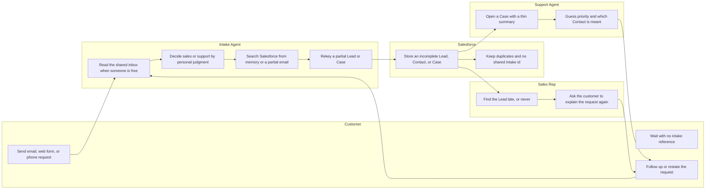

# As-is process

| | |
|---|---|
| Project | Intake-to-Salesforce CRM Integration |
| Phase | M1 — Discovery and design |
| Document | As-is process map |
| Version | 0.1 |
| Status | Baseline hypothesis. Not yet confirmed in a workshop. |
| Date | 24 November 2026 |
| Related | [Requirements](../requirements.md), [To-be process](to-be.md), [Solution design](../solution-design.md) |

## 1. How to read this map

This is the working picture of intake today, drawn so it can be compared with the to-be map lane for lane. It has not been confirmed with the people who run the mailbox or the Salesforce org. No volumes, timestamps, or interview quotes are claimed.

The Intake Agent lane is a person: whoever happens to monitor the shared mailbox, the web-form notifications, or the phone. The same five lanes are used on the to-be map.

## 2. What happens

1. The customer sends an email, completes a web form, or calls. Each channel lands in a different place. None of them returns a stable reference.
2. A person reads the shared inbox or the form notification when other work allows. Phone notes depend on who answered.
3. That person decides, without a written rule, whether the item is a sales Lead or a support Case. Mixed requests are split by habit. Consent for a later sales call is not recorded as its own choice.
4. They search Salesforce if they have time, often by a fragment of the email or by company. Several matches are resolved by picking the record that looks familiar.
5. They rekey what they remember into a Lead or a Case. Company, summary, and priority are often thin or blank. The original wording stays in the mailbox.
6. Salesforce now holds whatever was typed. Nothing on the record points back to a single intake id. A second person can create another Lead for the same email.
7. The Sales Representative may see the Lead late, or may work from the mailbox instead. The first conversation is spent reconstructing the request.
8. The Support Agent may see a Case with little summary and no reliable Contact. Priority is whatever was typed, including blank.
9. The customer, still holding no reference, follows up. The follow-up re-enters the inbox and can be typed in again.

Sales Manager and Support Lead are not lanes on this map because the current work does not give them a queue of holds, rejections, or failed commits. Oversight means asking someone to search a mailbox.

## 3. Pain this baseline is meant to test

| Pain | What the map shows | Who feels it | To-be response |
|---|---|---|---|
| No reference | The customer waits with nothing to quote | Customer, Support Agent | Intake id on every receipt (US-01, US-06) |
| Uneven intake | The inbox is read when someone is free | Customer, Support Lead | One path, with failed items kept visible (US-10) |
| Informal split | Sales versus support is personal judgment | Both teams | Classification Sales, Support, or Mixed (US-11) |
| No consent record | A sales call is not tied to a recorded yes | Customer | Granted, Declined, and Unanswered (US-02) |
| Rekey | The person copies a partial story into Salesforce | Sales Rep, Support Agent | Map the nine fields before one write (US-03, US-12) |
| Soft search | Partial email and memory pick the record | Sales Rep | Exact email only, otherwise a hold (US-04, US-08) |
| Duplicate records | Nothing stops a second Lead | Sales Manager | Update the one open Lead, or hold (US-04) |
| Thin Case | Summary and priority are optional in practice | Support Agent | Required summary and a priority crosswalk (US-05, US-09) |
| Lost items | Work can remain in the mailbox | Support Lead | Validation and commit failures stay visible (US-10) |
| No oversight queue | Managers cannot see holds or refusals | Sales Manager, Support Lead | Named holds and rejected Not a Fit items (US-07, US-08) |

## 4. What to confirm in a workshop

- Which channels actually exist, and which mailbox or form is the real front door.
- Who reads them, in what hours, and what they do with a mixed request.
- Whether any intake id, spreadsheet, or ticket tool already sits in front of Salesforce.
- How often the same email already exists on more than one Contact or open Lead. That count changes how large the future hold queue will be.
- Which Lead Status and Case Status values the org uses today.
- Whether anyone already captures consent, and under what wording.

Until those answers exist, do not treat this page as measured current state. The to-be map is the proposed target drawn against this baseline.
