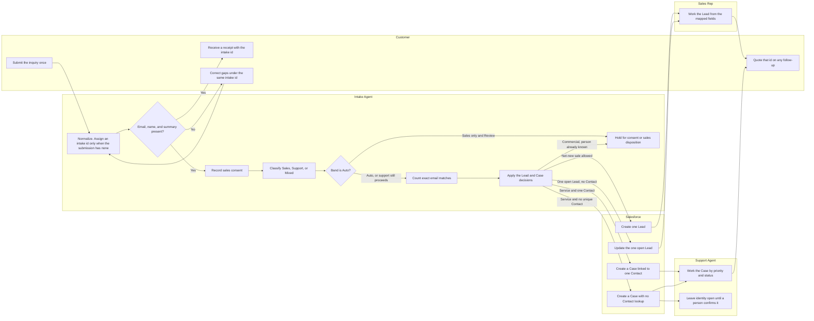

# To-be process

| | |
|---|---|
| Project | Intake-to-Salesforce CRM Integration |
| Phase | M1 — Discovery and design |
| Document | To-be process map |
| Version | 0.1 |
| Status | Proposed target. Not approved for build. |
| Date | 24 November 2026 |
| Related | [Requirements](../requirements.md), [As-is process](as-is.md), [Field mapping](../field-mapping.xlsx), [Solution design](../solution-design.md) |

## 1. What changes

The customer submits once and receives an intake id. The Intake Agent lane is the AI Intake Agent, applying the business rules before anything is written to Salesforce. Salesforce holds a Lead, a Case, or both. Intake does not create a Contact from the submission. People handle holds, identity disagreements, and the actual sales or support conversation.

The five lanes match the as-is map. Sales Manager and Support Lead act on the hold and review states inside the Intake Agent lane. They do not get extra lanes.



The Lead decision and the Case decision are the authority when the picture and the tables could be read two ways. Low-confidence support still creates a Case. Low-confidence sales does not create a Lead.

## 2. Steps

1. The customer submits once. The intake id is assigned immediately, including when the submission is incomplete.
2. Email is trimmed and lowercased. Name is split on the first space. Company whitespace is collapsed. The summary keeps the customer's words.
3. If email, name, or summary is missing, the customer is told what is missing. The intake id stays. Nothing is written to Salesforce.
4. If those three are present, the customer receives a receipt. The receipt says the request was received. It does not say a record is open, a person is assigned, or the issue is resolved.
5. The sales-consent choice on that submission is recorded as Granted, Declined, or Unanswered, with time, channel, and statement version.
6. The submission is classified Sales, Support, or Mixed, and banded Auto or Review. The working threshold is 0.70.
7. Exact email matches are counted separately for open Leads, closed Leads, and Contacts. Name and company are not match keys.
8. The Lead decision and the Case decision choose the write. Commit is the first moment Salesforce is changed.
9. The Sales Representative works only Leads that rule L7 or L8 wrote. Held commercial items stay with the Sales Manager.
10. The Support Agent works the Case. If Contact lookup is empty, the agent does not pick a Contact from memory. Identity stays unconfirmed until a person resolves it.
11. Status changes on the Lead or Case leave the creating intake id in place. A later intake id for the same Lead is appended to history.
12. The customer uses the same id on any follow-up. Search has to cover Lead, Case, and history.

## 3. Lead decision and Case decision

Match counts are exact matches on the normalized email. Closed Leads are not open Leads. For a Mixed intake the two decisions both run. A Lead result never cancels a Case, and a Case result never creates a Lead.

The first matching Lead rule wins. Lead rules run only when the class is Sales or Mixed. Otherwise there is no Lead.

| # | When | Lead result | Accountable next |
|---|---|---|---|
| L1 | Commercial assessment is Not a Fit | No Lead. Rejection is visible. | Sales Manager |
| L2 | Band is Review | No Lead. Classification hold. | Sales Manager |
| L3 | Sales consent is not Granted | No Lead. Pending Consent. | Customer, then Intake Agent |
| L4 | Contacts are 1 or more | No Lead and no Lead update. Sales hold. The Contact is not edited. | Sales Manager |
| L5 | Open Leads are more than 1 | No Lead. Sales hold. | Sales Manager |
| L6 | Open Leads are 0 and at least one closed Lead exists | No Lead. The closed Lead stays closed. Sales hold. | Sales Manager |
| L7 | Open Leads are exactly 1 and Contacts are 0 | Update that Lead. Do not reset status. Keep its intake id. Append the new id once. | Sales Representative |
| L8 | Open Leads are 0 and Contacts are 0 and no closed Lead exists | Create one Lead at Open - Not Contacted, in the unassigned sales queue. | Sales Representative |
| L9 | L7 or L8 was selected, and last name or company cannot be stored without a placeholder | Do not write the Lead. Keep the reason. | Sales Manager |

Case rules run only when the class is Support or Mixed. Band, consent, and Not a Fit do not stop a Case. The first matching Case rule wins.

| # | When | Case result | Accountable next |
|---|---|---|---|
| C1 | Contacts are exactly 1 | One Case. Contact lookup is that Contact. Identity line: Contact linked. Route by priority. | Support Agent |
| C2 | Contacts are 0 or more than 1 | One Case. Contact lookup is empty. Identity line: No Contact match, or Several Contacts. Route by priority. | Support Agent. Support Lead can see the unlinked Case. |

Open Leads do not change C1 or C2. A Mixed intake with one Contact and one open Lead creates a linked Case (C1) and holds the Lead (L4). It does not update that Lead, because the person is already a Contact.

## 4. Intake states

| State | Customer is told | Salesforce |
|---|---|---|
| Received | Receipt with intake id. Not assigned. Not resolved. | No write yet |
| Validation failed | What is missing, with the same id | No Lead and no Case |
| Pending Consent | Received. Sales will not call unless they grant consent | No Lead. A Case exists only when the class includes support |
| Pending Review | Received. Not yet assigned | No Lead. A Case exists only when the class includes support |
| Rejected | Received, and that there is no sales pursuit, in plain language | No Lead and, for pure Sales, no Case |
| Lead created | A later message may say who will follow up. The receipt itself must not | One new Lead |
| Lead updated | Same, against the existing pursuit | Existing Lead, original id preserved |
| Case created | A later message may quote the Case. The receipt itself must not | One Case |
| Commit failed | Received only. Do not say a Case or Lead exists | No partial record |
| Replay of a committed id | The existing result | No second record and no duplicate append |

Pending Review covers classification holds and ambiguous sales matches. The disposition values are Link, Update, Create, and Reject. One business day is the working aging mark only. Aging does not choose a disposition.

## 5. Priority path

| Stored intake priority | Lead Rating also set | Case Priority also set | Case path |
|---|---|---|---|
| P1 | Hot | High | Urgent |
| P2 | Hot | High | Urgent |
| P3 | Warm | Medium | Standard |
| P4 | Cold | Low | Standard |

Customer-stated priority is stored as stated. Priority inferred by the intake agent on a Review-band Case is stored as P3 until a person raises it. There is no topic path until a topic list is approved. A blank Contact lookup does not move a Case off its priority path.

P1 and P2 holds and failures are shown ahead of P3 and P4. That ordering is not a promise of a response time.

## 6. Description header

On create, Description starts with four lines, then a divider, then the customer's summary:

```text
Intake-Id: INT-20261124-0042
Classification: Support
Intake-Priority: P1
Identity: Contact linked
---
```

Identity is one of: Contact linked, No Contact match, Several Contacts.

On a Lead update, the original header stays. The new summary is appended with the newer intake id and the time. A replay of the same id does not append again.

Case Subject is the first 120 characters of the summary, on one line, with an ellipsis if it was cut. The header is not placed in the Subject.

## 7. Walkthroughs

Illustrative people and companies. They are not client data.

**A. Net-new demo request.** Jordan Lee, jordan.lee@example.com, Northline Analytics, asks for a pricing conversation and grants sales consent. No match. Class Sales, band Auto, company and last name present. Result: one Lead, qualification Sales Ready only if the ask is specific enough, otherwise Unqualified, status Open - Not Contacted, no Case.

**B. Help from a known person.** The same email already matches one Contact and the summary is a broken login. Consent is Unanswered. Result: one Case linked to that Contact, priority from the statement, no Lead.

**C. Second email while the Lead is open.** Jordan sends a different intake id with a sharper requirement. One open Lead, no Contact, consent still Granted, band Auto. Result: that Lead is updated, its status stays where the representative moved it, the first intake id stays, the new id is appended once.

**D. Urgent outage, two Contacts.** Samir Patel states that production is down and the email matches two Contacts. Result: one Case, Contact lookup empty, identity Several Contacts, priority P1 on the urgent path. Nobody picks a Contact. No Lead unless the class is Mixed and the sales gates also pass, which an outage does not.

**E. Existing customer asks for pricing only.** One Contact, class Sales, consent Granted, band Auto. Result: no Lead, no Case, sales hold for the Sales Manager. The Contact record is not edited.

**F. Missing email.** The receipt of acceptance is not sent. The intake id is kept. The customer is told email is missing. No Lead and no Case. When they reply with the address, the same id continues.

**G. Mixed, new logo.** The summary reports a fault and asks for a quote, consent Granted, no matches, band Auto. Result: one unlinked Case and one Lead sharing the intake id.

**H. Replay.** The channel delivers Jordan's committed submission again. Result: no second Lead, no second append.

## 8. Handoffs

| From | To | Condition | What the receiver can trust |
|---|---|---|---|
| Customer | Intake Agent | A submission | An intake id exists from this moment |
| Intake Agent | Customer | Validation failure | What is missing, and the same id |
| Intake Agent | Customer | Valid identity and summary | A receipt that does not claim an owner |
| Intake Agent | Salesforce | Route table says write | Fields follow the workbook |
| Intake Agent | Sales Manager | Sales hold, rejection, or classification hold | No Lead was created for that hold |
| Intake Agent | Support Lead | Unlinked Case, or a support commit failure | Priority and reason are visible, P1 and P2 first |
| Salesforce | Sales Representative | Lead created or updated | Required Lead fields are populated and consent was Granted |
| Salesforce | Support Agent | Case created | Summary, priority, status New, and a lookup only if it is unique |
| Sales Representative or Support Agent | Customer | Later, outside this intake step | The original intake id still finds the record |

## 9. Confirmation needed

The map is ready to walk in a workshop. It is not ready to configure. Before any later build, confirm the as-is baseline, the open questions in the solution design, and the Lead Status and Case Status values actually present in the org.
