# Solution design

| | |
|---|---|
| Project | Intake-to-Salesforce CRM Integration |
| Phase | M6 — Handover. The project package is complete. Earlier phases remain below. |
| Document | Solution design and decision log |
| Version | 0.6 |
| Status | Policy in sections 1–12 is still proposed. Metadata is source, not deployed. Python tests passed against local stand-ins. |
| Date | 24 November 2026 |
| Related | [Requirements](requirements.md), [Architecture](architecture.md), [Admin guide](admin-guide.md), [Demo script](demo-script.md), [Interview guide](interview-guide.md), [Flow design](flow-design.md) |

## 1. Context

The client receives commercial and support inquiries through more than one channel. Today those inquiries depend on a person reading a shared inbox and rekeying a partial story into Salesforce. The engagement exists to replace that habit with a single intake policy and a defined handoff into Lead, Contact, and Case.

This phase produces the policy. Salesforce remains the system of record for people, pipeline, and cases after a successful commit. The intake agent is the system of engagement up to that commit. No org has been inspected for this draft, and no current-state workshop has been recorded. The as-is map is the baseline the workshop should confirm or correct.

## 2. Problem statement

Customers cannot quote a reference, and they cannot tell whether a follow-up will be treated as a new request. Sales representatives meet people who were already in the org, sometimes on a second Lead. Support agents receive a thin Case, or receive nothing because the item stayed in a mailbox. Consent for a sales conversation is not a separate fact from "this person wrote to us."

The cost is rework, double outreach, and requests that cannot be found. The design target is narrower than a new CRM: one reference, one match rule, one Lead decision, one Case decision, and a field mapping a later phase can implement without inventing policy.

## 3. Scope

**In this phase**

- Context, problem, scope, assumptions, and open questions.
- The as-is baseline and the to-be route.
- Twelve user stories and the business rules they test.
- The decision log below.
- A field-mapping workbook for Lead, Contact, and Case.

**Not in this phase, and not authorized by this document**

- Creating or changing Salesforce metadata, record types, page layouts, flows, assignment rules, queues, or Apex.
- Data loader files, sample API calls, middleware, and sync jobs.
- Choosing a model, writing prompts, or connecting a channel.
- Deduplicating the existing org, migrating history, or designing a retention job.
- Territory design, staffing, and a customer-facing service-level agreement.

A later phase can start only after the open questions that it touches are closed and this draft is approved as policy. Approval of the policy is still not approval to build.

M2 was commissioned after this draft. It configures only the fields, validation rules, queues, permission set, and two flows named in section 13. Sections 1–12 stay the policy. The open questions are still open.

## 4. Assumptions

Each assumption is safe enough to finish discovery and unsafe to build on if it is wrong.

| ID | Working assumption | If this is wrong |
|---|---|---|
| A-01 | The client uses Salesforce Lead, Contact, and Case, and does not use Person Accounts. | The Lead versus Contact decision has to be reopened. |
| A-02 | Email is the identity the customer can reliably give. A login is not required to submit. | Match rules need a different key, and the workbook changes. |
| A-03 | English is the intake language for the first release. | Classification and name-splitting rules need a language decision before build. |
| A-04 | One Salesforce org receives the commits. | Ownership, search, and uniqueness of the intake id need an org strategy. |
| A-05 | Standard closed Lead statuses are Closed - Converted and Closed - Not Converted. New Leads use Open - Not Contacted. New Cases use New. | The status crosswalk is invalid until the org's values replace it. |
| A-06 | Sales consent is opt-in. Silence is Unanswered, and Unanswered does not authorize outreach. | Jurisdictions that allow a different basis would change BR-05. |
| A-07 | Classification confidence of 0.70 is the line between band Auto and band Review. | The hold rate changes. The shape of the Lead and Case decisions does not. |
| A-08 | Raw channel text is kept 24 months and then deleted. Records already in Salesforce follow the client's existing retention. | Legal may require a shorter or longer raw-text life. |
| A-09 | Aging of a sales hold is one business day, for visibility only. | A different aging mark changes the operations view, not the ban on timeout creates. |
| A-10 | No topic or product taxonomy is approved yet, so Case routing uses priority only. | A later taxonomy can add a path. It cannot be invented in the build. |
| A-11 | Automatically created Leads wait in one unassigned sales queue. This phase does not know territories. | Named assignment before this is agreed would break US-07. |
| A-12 | The as-is baseline in the process map is close enough to design against. | Workshop corrections flow into the to-be map before build. |
| A-13 | Existing duplicate Contacts and Leads will remain. This design protects new intakes only. | A data-cleanse project is separate work. High existing duplication makes more holds and more unlinked Cases. |

## 5. Open questions

None of these block finishing M1. The ones marked Yes block a later build of the slice they name.

| ID | Question | Working assumption | Blocks build of |
|---|---|---|---|
| OQ-01 | Which channels are in the first release: web form, email, chat, phone? | All four may appear later. The policy is channel-independent. Phone notes must still produce the same fields. | Channel connection only. Policy can be approved first. |
| OQ-02 | Which jurisdictions apply, and is opt-in legally required for sales contact? | Opt-in everywhere (A-06). | Any Lead write. |
| OQ-03 | How long may raw intake text be kept? | 24 months, then delete (A-08). | Retention tooling, not the field map. |
| OQ-04 | Where are pre-commit failures and holds visible? | A visible operations list ordered with P1 and P2 first. The store is not chosen. | The failure and hold stories. Not chosen here on purpose, so this phase does not invent an object. |
| OQ-05 | For a known Contact with a commercial ask and no service ask, should the outcome stay a manager hold, become a Lead, or become an Opportunity? | Manager hold. No automatic Lead and no Opportunity. | The known-customer sales path. The hold is the safe default until this is answered. |
| OQ-06 | May intake create an Account when the company text is new? | No. | Account data model. |
| OQ-07 | Are Person Accounts in use? | No (A-01). | Lead versus Contact. |
| OQ-08 | What are the live Lead Status and Case Status values? | Salesforce defaults (A-05). | Status mapping. |
| OQ-09 | Is 0.70 the confidence line the business wants? | Yes (A-07). | How many items land in Review. |
| OQ-10 | Is there a topic or product list for routing beyond priority? | No. Priority only (A-10). | Any route that is finer than urgent versus standard. |
| OQ-11 | What first-response targets and timezone should a later phase promise? | None are promised. Review aging is one business day for display. | Customer-facing commitments and staffing. |
| OQ-12 | Are languages other than English in scope? | No (A-03). | Parsing and classification beyond English. |
| OQ-13 | What daily and peak volumes should capacity planning use? | Unknown. Not required to approve the policy. | Staffing and queue design. |
| OQ-14 | Is a history field enough to find a later intake id, or is a child record required? | A history field is enough for this policy. Search must still find it (BR-32). | How search is built. The business rule stands either way. |
| OQ-15 | Is one operations role the disposition owner, or do Sales Manager and Support Lead keep the split in the handoff? | The split stands: sales holds with Sales Manager, unlinked Cases and support commit failures with Support Lead. | Queue ownership. |
| OQ-16 | What wording and version will the sales-consent statement use? | A versioned statement is required. The words are not written in this phase. | The consent attribute and the form. |

## 6. Architecture overview

The target has four responsibilities. Channels collect a submission. The intake agent applies policy. People dispose of what the policy will not decide. Salesforce stores the committed Lead, Contact, and Case.

```mermaid
flowchart TB
  customer["Customer"]
  channels["Channels: web form, email, chat, phone"]
  intake["AI Intake Agent: normalize, consent, classify, match, route"]
  review["Human review: Sales Manager and Support Lead"]
  boundary["Commit boundary. How the write is delivered is a later phase."]
  sf["Salesforce as system of record: Lead, Contact, Case"]
  rep["Sales Representative"]
  agent["Support Agent"]

  customer --> channels
  channels --> intake
  intake --> review
  review --> intake
  intake --> boundary
  boundary --> sf
  sf --> rep
  sf --> agent
  rep --> customer
  agent --> customer
```



Contact is drawn inside Salesforce because that is where identity already lives. The intake agent reads match counts from it and, on a unique support match, points a Case at it. The agent does not create Contacts and does not revise them.

The commit boundary is deliberate. This design says what must be true at the moment of the write. It does not say which API, file, or tool performs the write. Filling that in is a later phase.

Logical responsibilities:

| Responsibility | Held by | Not held by |
|---|---|---|
| The words of the request and the consent choice | Customer | Intake agent, which must not invent them |
| Intake id, normalization, classification, match counts, route | AI Intake Agent | Salesforce |
| Ambiguous commercial disposition | Sales Manager | A timeout, a representative, the intake agent |
| Priority paths and failed support commits | Support Lead | The Sales Representative |
| Working the Lead | Sales Representative | Intake agent after commit |
| Working the Case and its later status | Support Agent | Intake agent, which may set only New |
| Lead, Contact, and Case after commit | Salesforce | The mailbox |

Proposed custom fields appear in the workbook because standard fields cannot hold an intake id, a P1–P4 priority, or sales qualification without losing information. Naming them is not creating them. Standard fields are identified in the workbook as standard. Anything marked proposed stays unbuilt in M1.

## 7. Decision log

Status of every decision is **Proposed**. Nothing here has been accepted by the client.

### D1 — Lead versus Contact

**Decision.** A Lead is only for a person the org does not already know, and only for a commercial ask that passed consent, confidence, and the Not a Fit gate. A Case is for service, whether or not the person is known. A known Contact with a commercial ask and no service ask is held for the Sales Manager. Intake does not convert Leads, create Contacts, create Accounts, or create Opportunities.

**Options considered.**

| Option | Result | Why it was not chosen |
|---|---|---|
| Always create a Lead, then convert | One object for every inbound item | Support traffic and existing customers inflate the funnel and duplicate people who are already Contacts. |
| Never use a Lead. Write Contacts only | Identity is consistent | Unqualified strangers do not belong on Contact, and Company is a Lead requirement the business still needs for a new logo. |
| Recommended split | Lead for net-new sales, Case for service, hold when the person is already a Contact | Matches the stories and keeps Contact stable. |

**Consequences.** The automatic path leaves Lead contact lookup empty, because a known Contact never takes the automatic Lead path. Case contact lookup is the join for service. OQ-05 can later allow an expansion Lead or an Opportunity. Until it does, the hold is the behavior. A Mixed intake with no existing Lead or Contact may write one Lead and one Case. Mixed intakes for a known Contact write the Case and hold the commercial portion.

**Rules.** BR-10, BR-12, BR-14, BR-15, BR-16, BR-17.

**Owner.** Sales Manager, with Support Lead for the Case side.

### D2 — Duplicate handling

**Decision.** Normalize email by trimming and lowercasing it. Match that value exactly. Do not match on name or company alone. Do not merge records. Do not overwrite Contact fields. Do not reopen a closed Lead.

Sales writes:

- Zero Contacts and zero open Leads: create, when the other sales gates pass.
- Zero Contacts and one open Lead: update. Keep status. Keep the original intake id. Append the new id to history once.
- Any other sales pattern: hold for Link, Update, Create, or Reject.

Support writes:

- One Contact: set Case contact lookup, even if Leads also exist.
- Zero or several Contacts: create the Case with contact lookup empty.

A timeout cannot choose Link, Update, Create, or Reject.

**Options considered.**

| Option | Why it was not chosen |
|---|---|
| Fuzzy match on name and company | False links are worse than an unlinked Case. |
| Always insert a new Lead | This is the current pain. |
| Always update the oldest Lead when several are open | Quietly picks the wrong pursuit. |
| Auto-create a Lead when a hold ages out | Hides the queue by corrupting it. |

**Consequences.** Existing duplicates in the org will surface as holds and as unlinked Cases. That is acceptable, and it is a reason to run a separate data-quality effort rather than a reason to guess. Uniqueness of the intake id is per object: one Lead and one Case may share an id for a Mixed intake, and a second Lead or second Case may not. Search has to look at both objects and at history.

**Rules.** BR-08, BR-09, BR-11, BR-13, BR-18, BR-19, BR-28.

**Owner.** Sales Manager for sales dispositions. Support Lead for unlinked Cases. AI Intake Agent for the match counts.

### D3 — Consent

**Decision.** Service handling and sales contact are different purposes. Sales contact requires an explicit Granted value on that submission. Declined and Unanswered both mean no outreach and no Lead write. Neither value stops a Case. Consent stored for a later phase, and required before that phase can build, is the choice, the timestamp, the channel, and the statement version. A later submission records its own choice and does not rewrite an earlier record.

The statement text itself is OQ-16. This phase does not draft legal copy.

**Options considered.**

| Option | Why it was not chosen |
|---|---|
| Treat any inbound message as consent to be sold to | Conflates help with marketing and is the assumption A-06 rejects. |
| Block the Case until sales consent is answered | Punishes the customer for refusing a sales call. |
| Store consent only inside Description | Cannot be audited or suppressed reliably. |

**Consequences.** Some commercial mail will sit in Pending Consent. That is the intended cost of opt-in. The governed attributes are listed in the workbook so a later build does not ship the nine mapped fields and forget consent.

**Rules.** BR-05.

**Owner.** Customer for the choice. Sales Manager for the rule. Legal for the statement, still open.

### D4 — Data retention

**Decision.** Once a Lead, Contact, or Case exists, its retention is the client's existing Salesforce policy. This project does not shorten or lengthen that policy. Raw channel payload and conversation text, before and beyond the mapped summary, are assumed to be deleted after 24 months. Structured fields that were committed remain with the CRM record.

Intake must not request passwords, payment card numbers, or government identifiers. If a customer includes them, they are removed before commit and the stored summary says they were removed.

An erasure request is found by email and by intake id. Direct identifiers and the summary are redacted. The intake id itself remains so the erasure can be shown later.

**Options considered.**

| Option | Why it was not chosen |
|---|---|
| Keep raw channel text indefinitely because Salesforce keeps the Case | Copies more personal data than the Case needs. |
| Delete the Case summary on a fixed 24-month clock regardless of the open Case | Collides with support and legal holds the client already runs inside Salesforce. |
| Drop the intake id during erasure | Removes the proof that the request was found. |

**Consequences.** OQ-03 can change the 24-month raw-text figure without changing the field map. Redaction before commit is a business rule. The technique used to recognize a card number is a later-phase concern and is not specified here.

**Rules.** BR-33, BR-34.

**Owner.** Support Lead and Sales Manager jointly for the CRM record. Legal for the raw-text period.

### D5 — Case routing

**Decision.** Classification produces Sales, Support, or Mixed. Band Review means the intake agent does not create or update a Lead. Band Review does not stop a Case when the class is Support or Mixed, because a doubtful service request is safer on an unlinked or linked Case than in a silent queue. Inferred priority on that Review-band Case is capped at P3 unless the customer explicitly stated a higher urgency.

Until OQ-10 is answered, the only route is priority:

- P1 and P2 go to the urgent path.
- P3 and P4 go to the standard path.
- Empty Contact lookup does not change the path.

There is no fallback that drops a Case. Sales Leads that are created automatically wait in one unassigned queue for the Sales Manager. This phase does not invent territories.

The customer-facing receipt stays modest under BR-02. A later message may talk about a Case or a representative only after the corresponding write has succeeded.

**Options considered.**

| Option | Why it was not chosen |
|---|---|
| Hold low-confidence support until a person classifies it | Recreates the lost-mailbox problem for the people most in need of a Case. |
| Let inferred Review-band priority through as P1 | Floods the urgent path with guesses. |
| Design topic queues now | There is no agreed topic list. Empty topics would become a second drop point. |
| Assign Leads to named representatives from company name | Territory data has not been supplied. Wrong owners are harder to see than an unassigned queue. |

**Consequences.** The urgent path will contain real P1 and P2 work and also identity-unconfirmed Cases. Support Lead owns that mix. A future topic list can subdivide a path. It should not be added during a build as an undocumented field.

**Rules.** BR-06, BR-07, BR-16, BR-20, BR-21, BR-22, BR-23, BR-24.

**Owner.** Support Lead.

### D6 — M2 field and queue names

**Decision.** Configure the M2 names, and do not deploy the wider M1 proposed set in this phase.

| M1 proposal | M2 metadata |
|---|---|
| Intake id, shown as Intake_Id__c | `Intake_Ref__c` on Lead and on Case. Text 40, external id, unique, not case-sensitive. |
| Summary held in Description | `Intake_Summary__c` long text 5000 on Lead and Case. Description stays available for later notes. |
| Channel as a governed attribute | `Intake_Channel__c` restricted picklist: Web, Email, Chat, Phone. |
| Qualification picklist | `Qualification_Reason__c` long text on Lead only. The picklist is not created. |
| Urgent queue and standard queue | One Case queue, Support Tier 1. Priority changes the task and the monitoring clock, not the queue. |
| Unassigned sales queue | Lead queue Inbound Sales. |

The same intake reference may be stored on one Lead and one Case, because uniqueness is per field. A second Lead or a second Case with that reference is rejected. After the reference is stored, validation will not allow it to be changed or cleared.

**Status.** Configured in source. Not deployed. Policy approval for D1–D5 is still pending.

**Owner.** Engagement owner for the phase brief. Sales Manager for the lead queue. Support Lead for the case queue.

## 8. Write sequence

The intake agent applies this order every time. The workbook repeats it because the workbook is the field contract.

1. Assign an intake id if the submission does not have one.
2. Normalize email, name, company, and summary.
3. Validate. Stop with a visible failure when email, name, or summary is missing.
4. Record the consent attributes for this submission.
5. Classify and set the band. Remove secrets covered by BR-34 before any commit.
6. Count exact email matches.
7. Read the Lead decision and the Case decision.
8. Map fields only for the objects the table writes, using the workbook.
9. Commit. On replay of an id already committed, stop without a second write.

Description headers, status values, and priority crosswalks are specified in the to-be map and in the workbook. They are the same specification.

## 9. Risks

| ID | Risk | Likelihood | Impact | What this design already does | What remains |
|---|---|---|---|---|---|
| R1 | The org already has many Contacts sharing an email, so a large share of Cases are unlinked and many sales items hold. | High until measured | High operational load | Refuses to guess a Contact | A separate duplicate-cleanse project. OQ-13 for volume. |
| R2 | Live status values differ from the defaults in A-05. | Medium | Status mapping would be wrong if built as written | Calls the crosswalk an assumption and blocks build with OQ-08 | Read the org's picklists in a later phase. |
| R3 | Summaries contain payment data or credentials. | Medium | Harm to the customer and to the org | BR-34 bans asking for them and requires removal before commit | The detection method is not designed here. |
| R4 | Opt-in is the wrong legal basis for a market the client actually sells in. | Medium | Lead rule would be unlawful or commercially unworkable | A-06 is explicit and OQ-02 blocks the Lead build | Legal review of the statement and the basis. |
| R5 | Known-customer commercial holds pile up because OQ-05 stays open. | Medium | Sales delay on the existing book | The hold is visible and ordered | Close OQ-05 before expecting representatives to work expansion. |
| R6 | Without a topic list, the urgent queue mixes unrelated products. | High | Support Lead spends time sorting | Priority still separates P1/P2 from the rest | Approve a topic list only when the business has one. |
| R7 | Workshop shows the as-is baseline is wrong, for example a ticketing tool already sits in front of email. | Medium | Maps need to be redrawn | The as-is page is labeled a hypothesis | Confirm the baseline before treating M1 as accepted. |
| R8 | A later build stores consent in Description to avoid a new field. | Medium | US-02 cannot be audited | Governed attributes are listed as required for build | Reject a build that drops them. |

## 10. Responsibility

R is responsible for doing the step. A is accountable for the rule. C is consulted. Salesforce is omitted on purpose: after commit it stores the outcome, and it does not own the decision.

| Step | Customer | AI Intake Agent | Sales Representative | Support Agent | Sales Manager | Support Lead |
|---|---|---|---|---|---|---|
| Submit the request and the consent choice | R, A | C | | | | |
| Assign the intake id and normalize | | R, A | | | | |
| Qualify commercial fit | | R | C | | A | |
| Set priority definitions | | R | | C | A for Lead | A for Case |
| Ambiguous sales disposition | | C | | | R, A | |
| Work the Lead | | | R | | A | |
| Work the Case | | | | R | | A |
| Unlinked identity and failed support commit | | C | | C | | R, A |

## 11. Review path

Walk the package in this order.

1. Correct the as-is map with the people who actually touch the mailbox.
2. Run walkthroughs A through H on the to-be map. Change a Lead or Case rule if it is not how the business wants to behave.
3. Accept, amend, or reject D1 through D5. Record the decision in the approval block.
4. Check the workbook row by row, especially rows marked not stored. Those are decisions, not blanks to fill.
5. Close any open question that the next phase intends to build. Leave the rest open rather than guessing.

## 12. Phase boundary

M1 ends with the four discovery artifacts. M2 source configuration is recorded in section 13. It is not an integration, and it does not close the policy approval below.

Before that later work, the client would still need at least:

- Approval recorded below.
- OQ-02, OQ-05, OQ-07, and OQ-08 answered for the slices being built.
- A decision on where holds and failures live (OQ-04), made as its own design, not as an accidental custom object inside a build.
- Confirmation that existing duplicates (R1) are either accepted as hold volume or scheduled as separate cleanup.

| Role | Decision on D1–D5 and the Lead and Case rules | Name | Date |
|---|---|---|---|
| Sales Manager | Pending | | |
| Support Lead | Pending | | |
| Legal (consent and retention) | Pending | | |
| Engagement owner | Pending | | |

## 13. M2 configuration

M2 adds Salesforce metadata for intake ownership and follow-up. That phase itself stops at metadata: no Apex, no REST call, no Platform Event, and no Python. The later integration is section 14.

The source is the SFDX project at the repository root (`sfdx-project.json`, `manifest/package.xml`, `force-app/main/default`). No Salesforce CLI and no authenticated org were available, so this source has not been deployed. Runtime tests are written in the flow design and have not been executed in an org. The flow images there are diagrams of this metadata, not Flow Builder captures.

### What is configured

| Behavior | Where it lives |
|---|---|
| Lead assignment to Inbound Sales | Flow `Lead_Intake_Handling`, immediate path |
| Review task on that lead | Same flow, immediate path, task owned by the queue |
| 24-hour escalation | Same flow, scheduled path from CreatedDate. Runs only while Status is Open - Not Contacted. |
| Case assignment to Support Tier 1 | Flow `Case_Intake_Handling`, immediate path |
| Priority handling | Same flow. High creates an urgent task. Any other priority creates a standard task. |
| Response monitoring | Same flow. High and still New at 4 hours. Any intake case still New at 24 hours. |

Both flows run after save, and only when Intake Ref is set on create or first filled in later. A later edit that does not change Intake Ref does not create another review task. Changing the owner does not re-enter the flow. If the named queue is missing, the save is stopped with an error rather than leaving the record on the creating user.

Queues also support Task, so the queue can own the task it is given. Queue email to members is off.

### Permission set

`Intake_Integration` grants create, read, and edit on Lead and Case, and field access for the intake fields plus the standard fields a writer must set (name parts that are permissionable, email, description, rating, lead source, case priority, origin, supplied identity, contact, and account). It does not grant delete, view all, modify all, API access, or Apex. Record-triggered flows run in system context, so this set does not grant flow administration or task access. People who work the queues need ordinary sales or support access and queue membership. That access is not part of this permission set.

### Validation

Rules apply only when Intake Ref is populated, so ordinary leads and cases are unchanged.

- Format `INT-YYYYMMDD-####`.
- Reference cannot be changed or cleared once stored.
- Summary and channel are required with the reference.
- An intake lead set to Closed - Not Converted requires Qualification Reason.
- An intake case requires Priority.

### Explicitly not configured

Consent fields, classification, confidence, intake priority P1–P4, the qualification picklist, Contact changes, Account creation, assignment by territory, a second support queue, Apex, REST, Platform Events, and any sync job. OQ-08 still matters: the escalation path matches the standard status Open - Not Contacted, and the case paths match New. If the org renamed those values, the flows deploy and the scheduled paths do not fire until the values are aligned.

### Deploy

When an org is authorized:

```text
sf project deploy start --manifest manifest/package.xml
```

Then run the tests in `docs/flow-design.md`. Do not treat a successful static check of the XML as a passing org test.

## 14. M3 integration

M3 sends a finished intake conversation to Salesforce. A sales inquiry becomes a Lead. A support request becomes a Case. The write is a PATCH upsert on `Intake_Ref__c`, so the same reference updates the one record instead of inserting another.

The intake agent calls `Outbox.accept_conversation`. `OutboxWorker` delivers ready rows through `SalesforceClient`. Authentication is the client credentials grant for an External Client App. `SF_CLIENT_ID`, `SF_CLIENT_SECRET`, and `SF_TOKEN_URL` come from the environment. The access token is cached in memory and is not written to the outbox or to logs.

The SQLite outbox states are Pending, Retrying, Synced, and Dead Letter. HTTP 408, 429, 5xx, and network failures move a row to Retrying until five attempts, then Dead Letter. A 429 waits for `Retry-After` when Salesforce sends one. Any other HTTP error is Dead Letter on the first failure. Replaying an unchanged conversation that is already Synced does not send again.

Payloads omit Status and OwnerId. A replay therefore cannot pull a record backward or take it off the queue the M2 flows assigned. M3 does not publish Platform Events. Status comes back in M4.

The twenty sample conversations and the replay, retry, and routing checks are in `tests/`. They ran against an in-memory outbox and a local HTTP stand-in. They did not run against a Salesforce org.

## 15. M4 status synchronization

M4 publishes `Intake_Status__e` after the Lead or Case save commits. The event carries the intake reference, Lead or Case, the status, and the owner name. High-volume delivery keeps a replay id. Publish behavior is PublishAfterCommit, so a rolled-back save does not reach the subscriber.

`Lead_Status_Publisher` and `Case_Status_Publisher` run after the M2 assignment flows. They publish when an intake record is created or when its status or owner changes. The owner change is included so the event that follows queue assignment names the queue, not the integration user. Records without an intake reference do not publish.

`IntakeStatusResource` is the catch-up read at `/services/apexrest/intake/status`. It returns only those four fields, and only for rows that already have an intake reference. The caller supplies `refs`, `since`, or both. It is `without sharing` because the integration user no longer owns the record after the queue assignment. The permission set can call this class and can subscribe to the event. It still cannot publish the event and cannot delete records.

`integration/subscriber.py` stores the latest status per intake reference and object. It remembers the last replay id. A second delivery of that replay id is ignored. A new process reopens the same SQLite file and continues after the cursor. If Salesforce rejects the cursor, the subscriber calls the catch-up endpoint and then continues with new events only. One call processes one batch. M4 does not monitor the outbox and does not inject faults.

The duplicate, replay, restart, and missed-event checks are in `tests/test_status_sync.py`. They ran locally. They did not run inside a Salesforce org.

## 16. M5 retries, monitoring, and fault recovery

The retry matrix lives in `integration/retry_matrix.py` and is what the client and the token request use.

| Signal | Action | Outbox state |
|---|---|---|
| 401 on the API | Refresh the access token once | Unchanged when the new token works. A second 401 is Dead Letter. |
| 408 | Retry | Retrying, then Dead Letter on attempt 5 |
| 429 | Backoff | Retrying. Wait for `Retry-After` when it is present. |
| 5xx | Retry | Same schedule as 408 |
| 400 validation, and other 4xx except 401 and 408 | Dead Letter | Immediate |
| Network failure | Retry | Same schedule as 408 |
| Wrong client secret | Dead Letter | The token endpoint fails. There is no token to refresh. |

The schedule without a `Retry-After` header is 1, 2, 4, and 8 seconds, capped at 60. Attempt 5 is Dead Letter. A 401 that the client recovers does not increment the outbox attempt count.

`python -m integration.monitor` prints the current Pending, Retrying, Synced, and Dead Letter counts, the sum of attempts on Retrying rows, each dead letter, the status-row count, the replay cursor, and the last subscriber error. It reads once. It does not poll.

If the CometD call fails, the subscriber leaves the replay cursor where it was and records the error. The next run asks for events after that cursor. A duplicate conversation still produces one outbox row and one Salesforce upsert.

The matrix checks are in `tests/test_retry_matrix.py`. The six fault drills are in `tests/test_fault_drills.py`: wrong secret, network failure, validation failure, duplicate submission, API limit exceeded, and subscriber down. They ran against a local HTTP stand-in and a closed port. They did not run against a Salesforce org.

## 17. M6 handover

M6 packages the work for a reader who was not in the build. It does not change the integration. The reading order for a recruiter is the repository README, then this document, then [architecture](architecture.md). An administrator uses [admin-guide](admin-guide.md). A demo uses [demo-script](demo-script.md). Interview practice is in [interview-guide](interview-guide.md). Portfolio wording is in `docs/portfolio/`.

### Metrics counted from this repository

| Measure | Count | What it includes |
|---|---|---|
| Conversations | 20 | `tests/sample_conversations.py`, references INT-20261124-0001 through INT-20261124-0020 |
| Field mappings | 27 | Workbook rows L-01–L-09, C-01–C-09, and CS-01–CS-09 |
| Leads | 10 | Sample conversations whose route is Lead |
| Cases | 10 | Sample conversations whose route is Case |
| Platform event | 1 | `Intake_Status__e`, with 4 fields |
| Retry signals | 7 | The matrix in section 16. Delivery stops at attempt 5. |
| Python tests | 22 | `python -m unittest discover -s tests`, last run 22 tests, OK |
| Fault drills | 6 | Inside `tests/test_fault_drills.py` |

The Apex test class `IntakeStatusResourceTest` is in source. It has not been executed, because this package was not deployed. The workbook still shows the M1 name `Intake_Id__c`. The implemented field is `Intake_Ref__c` (D6).

### What a reader can rely on

Twelve user stories, thirty-four business rules, decisions D1–D6, four flows, two queues, ten validation rules, and the Python outbox, subscriber, and monitor. The as-is process is a baseline hypothesis. D1–D5 are still proposed. No production org has been changed.

